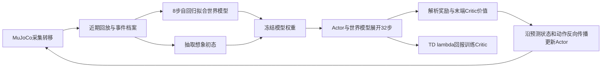

# Go2W SuperMimic训练分析与RP_wd迁移建议

日期：2026-10-30。分析对象：[uwvwko-zzz/go2w-supermimic](https://github.com/uwvwko-zzz/go2w-supermimic)，固定提交`a299ed5f5571da4492b8a286d94acfe4a86128e1`。本文读取了训练、世界模型、想象优化、地形奖励、课程、回放和策略代码，并以CPU、`weights_only=True`读取四份checkpoint；未运行该项目的MuJoCo仿真，未复现视频或验证实机效果。

## 结论与证据边界

这个仓库采用**模型式强化学习：学习动力学模型，再通过想象轨迹反向传播优化确定性Actor**。它没有使用PPO更新Actor，也没有MoE、Odin深度输入或示范动作库。虽然名称含Mimic，当前Go2W任务是速度控制，不是原始SuperMimic论文中的人形参考动作跟踪。

对本仓库最先值得迁移的是：**按局部地形放松腿部姿态/滚动限制、保持训练与测试指令覆盖一致、根据实际通过率放大速度、验证确定性Actor、保留成功与碰撞事件数据**。这些不依赖更换PPO。完整世界模型应另设实验，先证明RP_wd多步动力学和接触预测可靠，再考虑让Actor使用模型梯度。

不能把“视频出现20cm成功片段”理解为“所有20cm楼梯稳定通过”，也不能把原论文人形动作跟踪的计算收益直接外推到本机、RP_wd和视觉爬阶。

## 1. 实际训练循环

核心入口为[core/train.py](../go2w-supermimic/go2w_supermimic/core/train.py:72)，想象目标在[core/imagine.py](../go2w-supermimic/go2w_supermimic/core/imagine.py:125)。

1. 在物理仿真中执行`tanh(actor(obs)) + 0.15×OU噪声`，再裁剪到`[-1,1]`，记录状态、动作、下一状态、物理参数、接触和终止信息。
2. 世界模型用真实仿真片段监督学习；默认窗口8个控制步，即约0.16秒，自回归预测会让多步误差进入训练损失。
3. Actor更新时冻结世界模型和目标Critic的**参数**，但不关闭对输入、动作和状态的梯度。当前预设想象32步，约0.64秒。
4. Actor最大化整段折扣奖励与末端目标Critic价值；Critic拟合想象产生的TD(λ)目标，目标Critic参数按0.02的比例缓慢更新。
5. 世界模型下一轮继续更新，并非训练一次后永久冻结。梯度不穿过MuJoCo；Isaac Sim也可以作为数据来源，但必须重写RP_wd的数据适配层。

注意：`--actor-hold-iterations 20000`表示Actor学习率的保持区间，并非冻结Actor两万轮；仍有初期学习率渐入。`--num-steps-per-env 1`下的一轮也不同于本仓库每轮24步。

## 2. 三个网络各自知道什么

| 组件 | 输入 | 输出与用途 |
|---|---|---|
| Actor | 49维×5帧=245维：角速度、重力、12腿位置、12腿速度、16上一动作、3速度指令 | 16维`tanh`动作；部署仅使用这个网络 |
| 世界模型 | 38状态＋16动作＋16上一动作＋7物理参数＋273高度扫描=350维 | 38状态增量＋3平面位姿增量；v7另有接触/力和非轮碰撞辅助头 |
| Critic | 38状态＋3指令＋7物理参数＋16上一动作＋273扫描=337维 | 未来回报标量，训练时使用 |

38维状态包括根部高度、重力、机身线/角速度、腿关节位置/速度和四个轮速。7维物理上下文是四个轮子的摩擦与机身质心偏移。当前49维Actor**不接收实测轮速、真实线速度或地形扫描**；旧checkpoint可使用53维×5帧=265维，不能混为一谈。

所谓“世界模型”是带运行归一化、残差输出的三层512宽MLP。它不是视频生成模型、SLAM、Odin深度记忆或Dreamer的循环潜状态模型。273维扫描由已知静态箱体地形栅格产生；想象时根据预测位姿重新查询地图，不是网络生成下一帧深度图。该实现的地形图构建明确限制为静态box几何。

接触/力头是辅助监督；当前v7想象循环会使用非轮碰撞概率影响生存权重，但没有把预测接触力重新送入物理接触求解器。不能因此称它已实现完整接触动力学约束或可靠支撑规划。

## 3. 世界模型与PPO的区别

世界模型是预测组件，PPO是策略优化算法，两者并非互斥。可以在真实仿真中用PPO，也可以用模型生成数据再执行PPO。该仓库实际选择的是第三种组合：**世界模型＋可微轨迹策略优化**。

| 项目 | 本仓库当前Isaac Lab＋PPO | Go2W SuperMimic |
|---|---|---|
| 经验来源 | 当前随机策略的PhysX交互 | MuJoCo真实交互＋学习模型想象 |
| 策略更新 | 概率比率裁剪、优势估计；不求物理状态转移导数 | 奖励/价值沿预测轨迹反向传播到动作与Actor |
| 随机性 | 学习Gaussian均值和标准差，训练采样、回放用均值 | 确定性有界Actor；采集额外加OU噪声，想象动作不加该OU噪声，想象观测仍有噪声 |
| 历史数据复用 | 主要在近期on-policy批次中多轮更新 | 世界模型反复使用回放与事件档案 |
| 主要误差风险 | 探索、方差、奖励投机、训练/测试分布差异 | 同样存在奖励/分布问题，另有模型误差累积和错误梯度被策略利用 |
| Critic | 同样对采样窗口之后的未来进行bootstrap | 同样通过末端价值补偿有限想象长度 |
| 部署 | 策略单次前向 | 同样只运行Actor，不在线执行32步MPC |

不能据“32步想象比24步PPO采样长”推导后者只考虑24步，两者都有价值bootstrap。该仓库也没有提供与我们RP_wd、同奖励和同资源条件下的PPO对照，现有材料不能证明换算法一定更好。

原论文[SuperMimic](https://arxiv.org/abs/2610.28480)与[作者项目页](https://supermimic.github.io/)讨论的是人形动作跟踪：共享可微世界模型、短轨迹BPTT和Critic。其硬件、任务、动作数据和评测范围与当前轮足速度任务不同。

## 4. 值得借鉴的具体设计

### 4.1 按局部地形放松姿态，而非只按赛道类型切换

[terrain_posture.py](../go2w-supermimic/go2w_supermimic/core/terrain_posture.py:7)从机身附近高度扫描计算局部起伏。髋/膝屈伸姿态代价的系数由1平滑降到0.125；髋侧摆仍保留较强约束。

[rolling_rewards.py](../go2w-supermimic/go2w_supermimic/core/rolling_rewards.py:6)在局部起伏小于约2cm且接近直行时强化滚动偏好，起伏达到约6cm时允许抬轮；侧移/转向也会放松该偏好，考虑了不可转向轮的运动学限制。

本仓库当前主要按`course_mask`放松整个专项赛道。改成连续地形门控，可以做到同一条赛道的平地段稳定滚动，临近阶沿才释放屈伸自由度。首先修改奖励门控，不需要立即接MoE。其参数描述的是关节姿态代价，不是直接替我们解决机身单射线高度参考跳变；这仍要独立处理。

该仓库没有我们这种独立的固定机身高度跟踪奖励，但不能因此直接删除RP_wd高度保护。Go2W站高由模型、腿姿、接触和碰撞约束共同形成，几何与硬件均不同。

**版本边界：v6才启用逐轮局部净空奖励；v7明确是v5加非轮碰撞终止，没有启用v6实验分支。** 不能把`wheel_terrain_rewards.py`中的所有功能当作v7演示成功的已验证原因。

### 4.2 使用更贴近测试的训练指令

[mixed_commands.py](../go2w-supermimic/go2w_supermimic/core/mixed_commands.py:6)在台阶环境中约80%采样低速纯前进/后退，约20%保留混合指令；跨阶指令可以保持整个回合。普通地形也显式区分纯前进、纯横移、纯转向和组合控制。

这比只在训练中追踪世界终点、测试时改成固定机体系指令，更容易隔离基础运动问题。RP_wd可先让基础楼梯训练与固定`vx`测试对齐，同时单独保留姿态、转向和横移任务；不建议仍用一个汇总到点指标代表全部能力。

### 4.3 速度课程同时满足训练时间与性能条件

[stair_curriculum.py](../go2w-supermimic/go2w_supermimic/core/stair_curriculum.py:57)放大速度范围要求：达到最低轮次、对应上阶等级至少64次试验、通过率≥60%、平面速度MAE各分量<0.18且偏航MAE<0.30。台阶成功还检查跨过末阶的距离、落地高度、稳定性与至少两个轮子的接触。

本仓库虽然每个环境按安全成功升级，但全局速度和难度上限主要仍按轮次展开。更合适的迁移是为平地、上阶、下阶各等级维护真实回合计数，以完成/摔倒/停滞/冲击指标决定是否扩大指令范围；达标前继续在当前任务学习，不因时间到了就扩速。

也要看到它的实现边界：`stair_pass`不是逐轮落脚跟踪；后轮净空主要通过身体越过最后阶沿的几何余量和接触条件间接判断，需要检查是否适合RP_wd尺寸。

### 4.4 世界模型对稀有跨阶事件重点复习

[replay.py](../go2w-supermimic/go2w_supermimic/core/replay.py:77)保存接触变化、冲击、飞行、终止与成功上阶片段，避免世界模型只学会大量平地滚动。基础批次至少一半保持均匀采样，优先事件约四分之一；档案充足时各八分之一来自成功和稀有事件。

该优先采样用于**世界模型拟合**；想象初态仍使用普通回放采样。不能直接把旧轨迹塞入现有PPO优势更新而忽略on-policy要求。

终止数据也值得借鉴：复位后的状态不是摔倒前状态的正常后继。动力学多步窗口在终止后失效；v7只保留首个终止转移的碰撞标签，避免训练出“撞击后瞬移回出生点”的模型。

### 4.5 确定性Actor目标更贴近部署，但噪声不能只比较原始数字

Actor使用`tanh`限制输出；想象优化和部署都使用相同的确定性映射。真实采集另加固定强度、时间相关的OU噪声，相关系数0.95。这样减少了“训练优化一个带大Gaussian噪声的策略，部署只取均值”这一类目标差异，但仍有观测噪声与模型误差，不保证没有部署差距。

**不能说0.15比我们的约1.0小七倍，所以物理噪声也小七倍。** v7轮速缩放35，0.15对应约5.25rad/s随机目标量；RP_wd `model_1999`轮子标准差约1.03–1.09、缩放5，对应约5.15–5.46rad/s，幅度接近。区别主要在时间相关性、动作边界和Actor优化目标。OU噪声经裁剪后实际分布还会变化。

PPO需要正确的采样概率与`log_prob`。不能照搬“完全确定性Actor训练”，也不能在PPO动作外额外叠OU噪声却继续使用原Gaussian的概率比率。应先做随机/均值动作对照，合理调整探索强度与熵系数，并把确定性验收作为独立指标。

## 5. 附带checkpoint能证明什么

证据快照见[checkpoint审计数据](research/go2w_supermimic_checkpoint_audit.json)。下表是checkpoint中`curriculum_state.stats`的**训练统计**，不是独立确定性测试，且会随课程阶段重置；不同高度的试验分布也不完全相同。

| 上阶单级高度 | v7第15000轮：通过/试验 | 比例 | v7第20000轮：通过/试验 | 比例 |
|---|---:|---:|---:|---:|
| 2cm | 773/1187 | 65.12% | 775/1189 | 65.18% |
| 4cm | 1671/3106 | 53.80% | 1721/3180 | 54.12% |
| 8cm | 1728/3426 | 50.44% | 2047/3912 | 52.33% |
| 12cm | 1310/2338 | 56.03% | 2474/3954 | 62.57% |
| 16cm | 401/1125 | 35.64% | 1430/3025 | 47.27% |
| 20cm | 10/267 | 3.75% | 216/1201 | 17.99% |

两个v7模型的Actor权重输入均为245维。课程速度阶段均停留在1，对应vx约[-0.5,1.0]、vy±0.4、wz±1.0，而不是配置允许的最终±2m/s等范围。第20000轮8cm上阶统计仍不足60%，与未进入更高速度阶段一致。20cm下阶统计相对较高，但同样不能当作独立实机验证。

因此可以确认它存在成功跨阶行为与持续训练进步，不能据此宣称15k轮已可靠征服20cm。仓库没有提供同条件RP_wd/PPO基线、多种子确定性通过率报告或Go2W实机验证。

轮数也不可直接对比：v7第15000轮记录约6144万次真实转移（4096环境×15000物理控制步）；RP_wd每轮6144次转移（256×24），15000轮约9216万次。参考预设每次Actor更新另外使用8192×32个想象步，还执行4批世界模型更新。比较时应统计真实转移数、想象转移数、墙钟时间、GPU型号和峰值显存。

## 6. RP_wd完整迁移世界模型的风险

1. **机器人适配。** Go2W按FL/FR/RL/RR逐腿排列，RP_wd按ABAD/HIP/KENN/FOOT分组且腿序不同。轮半径约0.086m与0.1025m不同，腿长、质量、限位和PD也不同。FK、状态、动作、轮地几何和力标签必须重写，现有权重不能直接部署。
2. **动作尺度。** Go2W v7腿缩放约0.25/0.6/0.8、轮35；RP_wd是0.125/0.25/0.25、轮5。直接在现有Actor后加`tanh`会使轮速上限仅5rad/s、理想轮缘速度约0.5125m/s，已不足覆盖0.6m/s纯滚动目标。边界需按关节可达性和目标速度设计，训练与部署同步。
3. **物理随机化上下文。** 参考模型只显式输入摩擦/COM，其训练常量没有每环境PD增益随机化。本仓库还随机质量、增益、关节参数等；照抄7维上下文可能把不同动力学混为一谈，应加入相应特权参数，或先在固定参数下验证。
4. **接触和几何误差。** 单个MLP在轮地滚动上容易拟合，在抬轮撞阶/滑移/落地时未必有可靠梯度。当前代码未见模型集成不确定性约束或独立多步验证门槛，策略可能利用模型误差。预测损失下降不能替代真实仿真测试。
5. **视觉不在原实现范围。** 参考Actor盲走、模型读取真值地形。Odin的噪声、裁切、未知区域和深度历史需要另做表示与学生训练，不能把273维真值扫描当作实机已有输入。
6. **资源。** 参考默认4096环境、8192想象批次和32步反传不能直接照搬到16GB卡。仅默认近期回放404个float字段×512×4096约3.16GiB，另有事件档案、网络、反传激活和仿真占用。先以小批次、短想象窗口实测，禁止与当前Isaac Sim并行启动第二个仿真。
7. **归一化与导出。** 参考归一化均值/方差保存在Actor内，本仓库当前部署外部不做此归一化。可以研究把归一化封入ONNX以保持1740→16接口，但必须新模型训练并做PyTorch/ONNX数值一致性与完整契约验证。

## 7. 建议的实施顺序与验收

| 优先级 | 工作 | 可观察结果 |
|---|---|---|
| P0 | 同一checkpoint、同一初态，分别比较训练/测试配置与随机/均值动作；逐回合记录真实结果 | 定位当前几乎不前进来自采样、指令、随机化还是其他接口差异 |
| P1 | 保留PPO，试验局部地形门控姿态/滚动限制、固定低速跨阶指令、性能门控扩速 | 平地能按指令走，2/4/6/8cm上下阶逐项确定性通过；不靠高噪声凑出成功 |
| P1 | 增加Critic训练特权：真实线速度、接触和局部高度扫描；Actor保留部署可得输入 | 降低价值估计的部分可观测负担，单独做有/无特权对照；现有Actor接口可以保持 |
| P2 | 采集RP_wd转移，离线训练小世界模型，特别保留成功抬轮、撞击、滑移、终止前状态 | 按完整回合/地形/种子划分验证集，比较1/8/16/32步误差，接触切换与碰撞指标单独统计 |
| P3 | 模型通过验证后，另建模型式训练profile，先盲走基础教师，再研究Odin学生 | 与PPO按相同真实转移量和GPU小时对照，报告真实仿真而非想象奖励 |

如果仅增加预测辅助头而仍用PPO更新Actor，应称为“PPO＋预测辅助任务”；只有把模型用于想象优化等环节，才接近该仓库的算法路径。引入特权Critic是另一项独立改动，不等于已有世界模型。

验收优先统计确定性固定指令速度误差、各高度完整通过率、卡住比例、机身/腿碰撞、目标越限和PD估计饱和，并保留训练与测试分布差异。任何算法都不能用平均奖励或单段视频替代这些结果。

## 8. 阅读索引

- [仓库说明](../go2w-supermimic/README.md)、[Actor/归一化/观测](../go2w-supermimic/go2w_supermimic/core/policy.py)、[动力学模型](../go2w-supermimic/go2w_supermimic/core/world_model.py)、[地形与碰撞预测](../go2w-supermimic/go2w_supermimic/core/terrain_world_model.py)。
- [策略与模型训练循环](../go2w-supermimic/go2w_supermimic/core/train.py)、[可微想象与回报](../go2w-supermimic/go2w_supermimic/core/imagine.py)、[真实地形配置及版本分支](../go2w-supermimic/go2w_supermimic/env/terrain.py)。
- [性能课程](../go2w-supermimic/go2w_supermimic/core/stair_curriculum.py)、[混合指令](../go2w-supermimic/go2w_supermimic/core/mixed_commands.py)、[事件回放](../go2w-supermimic/go2w_supermimic/core/replay.py)。
- [原始SuperMimic论文](https://arxiv.org/abs/2610.28480)、[作者项目页](https://supermimic.github.io/)、[Go2W项目所标注的上游Go2实现](https://github.com/Zhengtianjin/go2-supermimic)。这些来源的任务与验证范围应分别理解。

本文提出的是迁移方案与代码审计结论，没有将世界模型、门控奖励或特权Critic接入当前RP_wd训练。后续修改须另开版本、保留对照，并遵守单仿真实例与部署契约约束。
