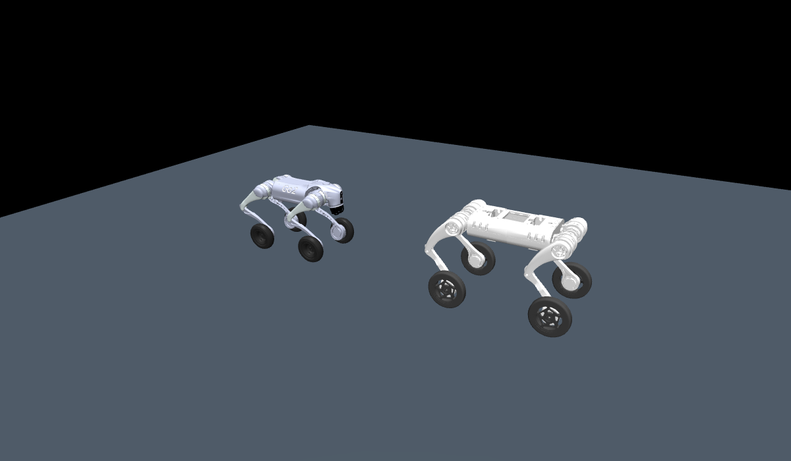

# 轮足大狗迁移到 Go2W SuperMimic

2026-11-10。分支：`codex/rpwd-go2w-supermimic`。工作区：`/media/rmer/系统/rpwd_training/worktrees/rpwd-go2w-supermimic`。

本版本把本仓库的 **RP_wd 轮足机器人**接入 Go2W SuperMimic 世界模型训练。原版Go2W源码与既有实验继续保留；新包提供`--robot rpwd`和`--robot go2w`，两种机器人通过同一Learner、奖励、地形、随机化及修正版课程训练。它与原有Isaac Lab轮足/点足任务并存。

## 1. 代码与来源

- 新包：`rl/rpwd_go2w_supermimic/`，从[Go2W SuperMimic](https://github.com/uwvwko-zzz/go2w-supermimic)提交`a299ed5f5571da4492b8a286d94acfe4a86128e1`适配。
- 原文件SHA256记录在新包`UPSTREAM.json`；保留MIT许可及Go2W机器人资产许可。原Go2W模型资产随新包保存，因此运行新包不依赖未纳入本仓库的参考克隆。
- RP_wd来源：`description/RP_wd/urdf/RP_wd.urdf`与同目录对应的`mjcf/RP_wd.xml`。现有MJCF包含几何与惯量，但原来固定底座、腿kp=21且轮子为位置驱动，不能直接当成当前训练模型使用。
- 适配器在内存中为RP_wd添加浮动底座、替换执行器并统一逻辑关节别名；原URDF/MJCF文件保留。实际RP_wd关节LF/RF/LB/RB映射到FL/FR/RL/RR，ABAD/HIP/KENN/FOOT映射到hip/thigh/calf/wheel。

## 2. 相同的训练与必要的物理差异

| 项目 | 两种机器人共享 |
|---|---|
| 算法 | 可微残差世界模型、真实转移回放、32步想象BPTT优化确定性Actor、TD(λ) Critic |
| Actor | 本体感知49维×5帧=245维，不接深度/地形/真实轮速，输出16维tanh动作 |
| 49维单帧 | 机身角速度3、重力3、腿位置差12、腿速度12×0.05、上次动作16、速度指令3 |
| 历史 | 每项分别旧→新，首帧复制填充 |
| 世界模型 | 350维输入，38维状态变化+3维平面位姿变化，含接触/力及非轮碰撞预测头 |
| Critic | 337维特权输入，含21×13高度扫描、摩擦/COM与真实轮速状态 |
| 时间 | 原生MuJoCo/MuJoCo Warp物理200Hz，策略50Hz |
| 默认规模 | 4096环境、512步回放、WM batch2048/window8/update4、想象batch4096/horizon32 |
| 网络 | 世界模型512×3；Actor/Critic 256/128/64 |
| 优化 | Adam lr=2e-4，Actor倍率0.3；Critic每轮5epoch×4minibatch；γ=.99，λ=.95 |
| 采集 | OU动作噪声0.15，世界模型预热300轮，优先回放与成功事件回放 |
| 学习率 | Actor前1000轮渐入，20000轮平台期，之后20000轮余弦衰减至20% |
| 归一化动作尺度 | 腿逐腿0.25/0.6/0.8rad，轮35rad/s；与原v7一致 |
| 地形 | 平地/双向上下阶/平台/坡道/碎石，阶高2/4/8/12/16/20cm |
| 域随机化 | 沿用原版startup轮地摩擦0.3–1.2、COM偏移、编码器偏差及reset范围 |
| 奖励 | 原v7相同函数与权重，真实与想象共享解析奖励；保留原版低权重力矩项2e-5 |

RP_wd物理参数取自本仓库部署契约，不能用Go2W电机参数代替：

| 参数 | 原Go2W | RP_wd轮足 |
|---|---:|---:|
| 总质量 | 约19.126kg | 约20.550kg |
| 默认腿角 | 原Go2W站姿 | ABAD=0、HIP=0.72、KENN=-1.41 |
| 腿kp/kd | 20/1、20/1、40/2 | 三类均100/3 |
| 腿力矩限幅 | 23.5/23.5/45N·m | 42N·m |
| 轮速度增益、力矩限幅 | 2、45N·m | 3、17N·m |
| 轮半径 | 0.086m | 0.1025m |
| 自碰撞 | 原资产设置 | 与既有RP_wd设置一致关闭 |

RP_wd逐连杆质量/惯量、关节轴/限位与URDF检查；可微轮端FK读取URDF零位变换和圆柱尺寸，不使用Go2W腿长。FK与原生MuJoCo随机姿态逐轮对比，并保留动作梯度。世界模型没有轮角，圆柱微小径向偏心按零轮角处理，位置误差上界约0.08mm。

MuJoCo原生伺服强制的是关节位置限位与执行器力矩限幅；URDF关节速度上限不作为直接截断qvel的非物理约束。真机电机带宽、时延、速度饱和仍需实测标定。

## 3. 修复阶段1卡住的问题

原实现用本阶段累计8cm上阶通过率晋级，早期失败长期保留；成功环境不断升级到更高地形，导致8cm新样本不足。新实现：

1. 每个考核高度保留最近256次有效回合，至少128次样本、通过率≥60%才可晋级。
2. 保留原轮数门槛0/3000/8000/15000/22000及速度误差门槛：xy最大误差<0.18m/s、yaw<0.30rad/s。
3. 固定约20%的上阶环境在当前考核高度4/8/12/16cm，其余环境继续按真实成功/摔倒升降级。
4. 扩速前开始的旧回合不计入新阶段考核；晋级后近期窗口清空。考核环境在自然复位时换高度，不中途瞬移污染转移。
5. checkpoint保存环形窗口、累计写入计数及阶段。恢复旧Go2W模型时保留原阶段/优化器/累计日志，近期窗口从空开始，不用历史累计成绩冒充近期表现。
6. 日志增加`promotion_window`：目标高度、样本数、通过率、门槛与考核环境数。地形平均等级不再替代晋级证据。

可通过`--promotion-window`、`--promotion-min-trials`、`--promotion-pass-rate`和`--probe-fraction`配置，默认分别为256/128/0.6/0.2。续训会检查这些参数是否一致。

## 4. 启动训练

现有独立Python依赖环境继续复用，所有新日志、缓存和模型默认保存到可写的`/media/rmer/系统/rpwd_training/rpwd_go2w_supermimic/`。可用`RPWD_GO2W_PYTHON`和`RPWD_GO2W_DATA`覆盖。默认磁盘未挂载时会拒绝启动。

```bash
cd /media/rmer/系统/rpwd_training/worktrees/rpwd-go2w-supermimic

# RP_wd轮足从零训练，默认4096环境、60000轮；完成后串行CPU评测与ONNX导出。
./rl/scripts/run_rpwd_go2w_experiment.sh --robot rpwd

# 使用相同算法、修正版课程训练Go2W对照。
./rl/scripts/run_rpwd_go2w_experiment.sh --robot go2w

# 只训练；所有参数都可在命令末尾覆盖。
./rl/scripts/train_rpwd_go2w.sh --robot rpwd --iterations 60000

# 完整恢复对应机器人的checkpoint，总轮数必须大于已保存轮数。
./rl/scripts/train_rpwd_go2w.sh --robot rpwd \
  --resume /绝对路径/model_20000.pt --iterations 60000

# 将既有原版Go2W模型导入修正版课程继续训练（必须指定go2w）。
./rl/scripts/train_rpwd_go2w.sh --robot go2w \
  --resume /绝对路径/原版Go2W/model_60000.pt --iterations 80000
```

GPU训练入口会拒绝与现有GPU训练或Isaac仿真并行；CPU验证需显式传`--device cpu`，会隐藏CUDA设备。训练默认无窗口，使用systemd-inhibit阻止休眠。未自动启动RP_wd正式长期训练。

新格式checkpoint包含`robot_id`与物理契约指纹。即使两者都是245→16，仍会拒绝Go2W和RP_wd交叉恢复，或在资产、驱动、历史、地形版本、课程参数变化后静默续训。已有Go2W权重仅支持作为Go2W模型导入，不能当作RP_wd已学会行走的模型。

## 5. 原生查看器、评测与导出

```bash
# 自动选最新RP_wd正式模型。按住方向键前后/横移，Q/E转向，松开归零。
./rl/scripts/play_rpwd_go2w.sh --robot rpwd --lane stairs8
# 指定模型；R复位，1..8切换三维赛道，Space停止，Esc退出。
./rl/scripts/play_rpwd_go2w.sh --robot rpwd --checkpoint /绝对路径/model_60000.pt

# 两种机器人使用同一测试场；Go2W旧格式检查点也可指定后回放。
./rl/scripts/play_rpwd_go2w.sh --robot go2w --checkpoint /绝对路径/Go2W/model_60000.pt

# 固定指令、3种子评测并保存summary.json及逐帧CSV。
./rl/scripts/play_rpwd_go2w.sh --robot rpwd --mode evaluate \
  --checkpoint /绝对路径/model_60000.pt --seeds 0 1 2

# 导出独立ONNX和候选ROS2配置。
./rl/scripts/export_rpwd_go2w.sh --checkpoint /绝对路径/model_60000.pt
```

三维场景复用`GO2W_NATIVE_TEST_PARK.md`所述8赛道和3档难度。Actor没有视觉导航，绕障赛道需人工选路。

RP_wd导出产物为`policy_supermimic_rpwd.onnx`、`supermimic_rpwd.yaml`与`contract.json`。五帧输入245维，部署侧观测排列为角速度/重力/腿位置/腿速度/上一动作/指令；ONNX内部逐帧重排上一动作到训练顺序。输出采用LF/RF/LB/RB逐腿三关节后四轮，通过独立`usd2urdf`映射到硬件。它不兼容既有168/1740维策略，不能直接覆盖普通profile的模型。

候选配置沿用已有硬件安全边界，控制周期50Hz；原168/1740配置和ROS2实现保持其既有用途。硬件的400Hz底层控制与MuJoCo 200Hz物理并不数值等价，当前未执行真机部署。新盲策略不含roll/pitch/高度指令输入。

## 6. 验证结果与边界

证据目录：`/media/rmer/系统/rpwd_training/rpwd_go2w_supermimic/`。

- CPU端到端：12环境、48轮、40次Actor更新；从48续到64轮累计52次更新，跳过与异常环境恢复均为0。此处缩小了验证批量/想象长度，正式入口默认保持原规模。
- 原版Go2W也通过共享入口12环境16轮、8次更新；原49000轮checkpoint完整导入后Actor权重逐项完全相等；通过新入口在8cm上下阶原生测试中到点。
- 16项回归检查通过，覆盖机器人质量/逐连杆惯量、关节轴和限位、可微轮端FK、动作梯度、旧失败退出窗口、最低样本/通过率/误差门槛、考核池、近期状态恢复、跨阶段回合隔离、机器人与课程契约、上游模型/奖励一致性、编译想象梯度等回归检查通过。
- ONNX Runtime CPU与PyTorch在16组随机输入上的最大误差约5.4e-8（CPU短模型）；GPU317轮验证模型误差为5.96e-08；独立场景MJCF及网格可重载。原训练部署静态契约校验`verify_contract.sh --no-sim`通过。
- RP_wd短模型原生平地5秒没有翻倒，倾角约0.9°，尚未学会跟随指令；这只是资产/控制链路检查，不是训练效果结论。
- GPU续训：从305恢复至317轮，累计9次Actor更新，跳过0次、异常恢复0次；近期窗口中的13次考核记录完整保留。验证时将恢复预热缩短为8轮，正式训练默认仍为300轮。
- GPU全规模：原版60000轮训练和自动评测完成后，RP_wd以4096环境、WM batch2048/window8/update4、想象batch4096/horizon32完成305轮，300轮预热后5次完整编译Actor更新，跳过0次、异常恢复0次；训练循环105.9秒，采样显存峰值14452MiB（训练进程13410MiB）。这是起训验证，不代表大狗已经学会过台阶。日志及模型在`validation_rpwd_gpu4096_v1.log`和`validation/rpwd_gpu4096_v1/`。

原生静态模型对比：左为Go2W、右为RP_wd轮足。它只展示资产，不代表策略已收敛。



机器可读验证摘要：[rpwd_go2w_validation.json](research/rpwd_go2w_validation.json)。
