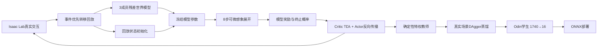

# RP_wd SuperMimic模型式训练第一版

本方案在独立分支 `codex/supermimic-adaptation` 实现，不改 `main` 上的PPO训练流程。按本地参考仓库 `go2w-supermimic` 的算法链路，在Isaac Lab/PyTorch中重实现RP_wd版本；不直接依赖其MuJoCo/MJLab机器人代码。Isaac Lab提供真实交互，集成世界模型拟合动力学和奖励，再从回放状态展开短想象轨迹，通过模型梯度更新确定性教师Actor。教师随后在学生实际访问的状态上做DAgger式在线蒸馏，产出部署端Odin深度策略。



## 1. 对接RP_wd的模型定义

| 数据 | 维度 | 内容 |
|---|---:|---|
| 世界状态 | 38 | 根部高度、投影重力、机身线/角速度、12个腿关节相对位置、16个关节速度 |
| 动作 | 16 | Isaac Lab关节动作顺序的原始策略值，训练和部署均裁剪在±10 |
| 指令 | 6 | 速度指令(vx、vy、wz)与姿态/高度指令(pitch、roll、height) |
| 特权地形 | 192 | RayCaster前向真值高度扫描，1×16×12，按机身高度归一化 |
| 辅助真值 | 12+4 | 归一化腿部执行器力矩、四轮接触/法向载荷 |
| 模型输出 | 250+5 | 状态增量38、平面位姿增量3、下一扫描192、腿力矩12、轮载荷4、环境奖励1；另预测4轮接触和终止概率 |

动力学输入268维：状态38＋动作16＋上一动作16＋指令6＋扫描192。确定性教师输入268维：状态、指令、上一动作、真值扫描、腿力矩、轮接触。Critic额外接收轮载荷，为272维。教师不是部署模型，不能直接给机器人使用。

世界模型用**3个独立成员**估计状态、扫描、执行器反馈、实际Isaac Lab总奖励和真实终止标签；每个成员用不同的回放子样本训练。窗口按8步自回归拟合，越过回合终止的窗口会截断。碰撞/终止、轮接触变化和高轮载荷片段加入事件采样，但均匀回放仍占大多数。Actor想象时用模型集成均值，并扣除模型分歧；默认想象8步，约160 ms。模型参数被冻结，但动作到状态/奖励的计算图保留，Critic使用TD(λ)目标和0.02软更新。

扫描图由世界模型直接预测下一策略步，不在Isaac物理环境外执行射线查询。模型不负责求解接触约束；接触与载荷预测用于教师输入和辅助监督。策略仍必须在真实PhysX地形上独立评测，想象回报不能作为过阶通过证据。

## 2. Odin深度学生与部署接口

模型式教师在学生实际采集到的仿真状态上提供确定性动作。学生通过DAgger混合动作逐渐接管环境，并以Huber动作回归训练。学生只读原部署策略的本体历史与深度记忆：

- 本体/腿力矩历史：68×3＝204维；
- Odin深度记忆：8×16×12＝1536维；
- 单输入策略：1740维；输出16维原始动作，范围平滑限制在±10。

学生不读取真值RayCaster、仿真机身速度或接触力。训练结束后脚本会导出并校验单文件 `policy_odin_supermimic.onnx`，I/O为`obs[1,1740] → actions[1,16]`。模型不会自动覆盖部署端文件；先用本分支回放和固定场景测试，通过后再手动部署。测试脚本为 `play_supermimic.sh`，对应的checkpoint是`student_final.pt`。

## 3. 运行命令

必须先确认没有其它Isaac Sim/训练/测试进程。训练脚本强制headless、调用并发守卫并阻止系统休眠；教师和学生必须**依次运行**。

```bash
# 教师：默认100000次更新，每次先采集24个50Hz真实仿真步；默认64环境
./rl/scripts/train_supermimic.sh --stage teacher \
  --num_envs 64 --iterations 100000 --seed 42 --run_name wm_v1

# 教师续训；--iterations表示希望达到的累计总轮数，仿真状态和回放池会重建并重新热身。
./rl/scripts/train_supermimic.sh --stage teacher --resume_teacher /path/to/teacher_latest.pt \
  --num_envs 64 --iterations 100000 --seed 42 --run_name wm_v1_resume

# 学生：教师完成后，把路径替换成上一步输出的 teacher_final.pt
./rl/scripts/train_supermimic.sh --stage student \
  --teacher_checkpoint /path/to/teacher_final.pt \
  --num_envs 64 --iterations 20000 --seed 42 --run_name odin_student_v1

# 学生GUI回放
./rl/scripts/play_supermimic.sh \
  --checkpoint /path/to/student_final.pt \
  --num_envs 8
```

教师日志、配置和权重位于`rl/logs/supermimic/teacher/`，学生产物位于`rl/logs/supermimic/student/`。正式扩展环境数和训练轮数前，应先在Isaac Sim可用时完成短流程运行和固定场景评估。

默认100000次教师更新对应2.4百万次每环境控制步，才能覆盖已有地形/姿态课程后段的时钟。完整训练耗时取决于显卡、环境数和传感器渲染，不应把“100000”解释成100000条物理转移。

## 4. 评估、边界和待完成项

第一版实现了世界模型集成、事件回放、8步自回归拟合、奖励/终止预测、想象轨迹反向传播和深度学生蒸馏/ONNX导出代码。想象奖励裁剪默认±300，保留课程中250分到点成功奖励信号。尚未在Isaac Sim启动仿真，也没有新模型、确定性台阶通过率或相机渲染结果；因此目前只能称为**代码首版**，不能声称训练收敛或已解决过台阶。

首轮应先跑上面的短流程，再用小环境数训练若干千次更新，检查模型状态/高度图多步误差、终止校准、Actor动作和固定场景的真实仿真通过率；模型训练损失低不等于跨阶动力学准确。重点观察转移误差在1/4/8步的增长、首次抬轮/落地片段、轮端接触预测、模型分歧与Actor确定性测试。通过门槛后再扩大到64/128环境和完整课程。

版本限制：

1. 首版世界模型拟合Isaac Lab合计奖励，包括稀疏台阶奖励；奖励模型容易被Actor利用，所以使用短想象窗、模型集成分歧惩罚，并要求真实仿真验证。
2. Isaac ManagerBasedRLEnv在终止后会自动复位。终止转移的终止/奖励标签仍训练，复位后的伪下一状态不参与动力学与接触回归。
3. 教师和学生各有自己的输入结构。部署只允许学生1740→16；特权教师checkpoint不可交给ROS推理节点。
4. 旧的 `SuperMimic-Teacher-v0` / `SuperMimic-Student-v0` 仍是上一版PPO教师/蒸馏对照。真正的模型式任务显式带 `SuperMimic-WM-`，由`train_supermimic.py`驱动，不使用RSL-RL PPO来更新Actor。
5. 教师续训恢复网络、优化器和课程总步数；PhysX状态、环境地形等级及回放数据不会从checkpoint恢复，重启后回放需重新热身，不能视为逐位完全连续的仿真续跑。

Go2W算法审计与适配差异见 [GO2W_SUPERMIMIC_ANALYSIS.md](GO2W_SUPERMIMIC_ANALYSIS.md)。部署观测、帧栈和动作尺度仍以[契约表](README.md)及`rp_wd_contract.py`为准。
