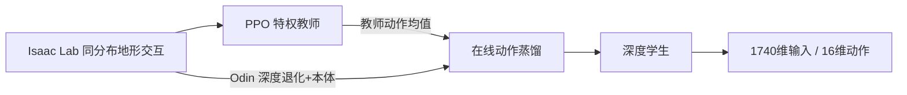

# 历史版：SuperMimic启发的PPO教师—深度学生对照

此文档记录首次迁移时的PPO教师/蒸馏原型，保留作算法对照。它不是完整SuperMimic世界模型实现。当前模型式主方案、训练入口与部署学生见 [SUPERMIMIC_MODEL_BASED.md](SUPERMIMIC_MODEL_BASED.md)，位于分支 `codex/supermimic-adaptation`。本文提到的`SuperMimic-Teacher-v0`和`SuperMimic-Student-v0`旧任务仍可作为PPO对照；模型式任务名带`SuperMimic-WM-`。

## 训练链路



### 阶段一：PPO 特权教师

- 本体输入：原有 Odin policy 68维单帧 × 3帧 = **204维**。
- 真值地形：机身前方 RayCaster 高度图，**1×16×12**；前向覆盖约 -0.4 到 +1.1 m，横向约 1.1 m。相对机身高度编码并裁剪到 ±0.5 m。
- 真实动力学状态：**11维**，机身坐标系线速度3、角速度3、脚下净空1、四轮法向接触力4。
- 教师 Actor 与 Critic 可使用上述特权组。教师场景不创建 Odin 相机，避免重复渲染。
- 使用现有 100000 轮地形、速度、姿态/高度与推扰课程；实验目录独立写入 `rp_wd_odin_supermimic_teacher`。

### 阶段二：在线蒸馏深度学生

- 教师在学生实际访问的仿真状态上根据真值高度图和真实状态输出确定性动作均值。
- 学生只接收原有 204维本体历史和 **8×16×12** Odin 深度记忆，即部署输入 **1740维**；不把特权高度图、真实机身速度或接触力送进学生。
- 深度采用现有噪声、裁切、遮挡、丢帧和延迟配置。学生 PPO 蒸馏更新默认 5000 轮，日志独立写入 `rp_wd_odin_supermimic_student`。
- 教师 checkpoint 先严格载入教师网络；学生只迁移兼容的部分：共同本体输入列、教师高度图 CNN 到深度 CNN（单输入通道权重按8帧均摊）、兼容的 MLP 层。教师独有的11维状态列不拷入学生。输入层不匹配时初始化程序会中止并说明结构不符。
- 学生 checkpoint 可由现有 OdinDepth Play/PPO runner 加载；导出的部署接口仍是 **1740→16**，无需修改部署 YAML 或 ROS 节点。

## 与 Go2W SuperMimic 的关系

| Go2W SuperMimic | 本分支第一阶段迁移 |
|---|---|
| Actor不读高度扫描；世界模型和Critic读取真值地形/物理上下文 | PPO教师读取真值高度图与仿真状态；部署学生不读特权组 |
| 世界模型学习动力学，再沿想象轨迹优化确定性Actor | 先用已验证的Isaac Lab PPO训练教师，再在真实仿真rollout上在线蒸馏 |
| 静态地形高度图由模型查询，轮速与接触事件也进入模型 | 使用Isaac Lab RayCaster和ContactSensor真值；不复制Go2W关节序、尺寸或模型权重 |

因此本分支是**特权教师/传感器学生迁移**，不是完整复刻 SuperMimic 世界模型算法。先验收教师的确定性上阶能力，再验收学生相对教师的性能差距；如果学生追不上，再考虑增加示范回放或 PPO 学生微调，不直接假设蒸馏成功。

## 启动顺序

训练必须串行运行，不能和当前 v24 或任何其他 Isaac Sim 同时启动。

```bash
# 1. 特权教师：新任务、新实验目录，从头训练
./rl/scripts/train_odin_depth.sh \
  --task Isaac-Velocity-Rough-RPWD-OdinDepth-SuperMimic-Teacher-v0 \
  --num_envs 256 --seed 42 --max_iterations 100000 \
  --experiment_name rp_wd_odin_supermimic_teacher --run_name privileged_teacher_v1

# 2. 先在教师专用Play任务评测，checkpoint替换为教师训练输出
./rl/scripts/test_policy.sh \
  --task Isaac-Velocity-Rough-RPWD-OdinDepth-SuperMimic-Teacher-Play-v0 \
  --checkpoint rl/logs/rsl_rl/rp_wd_odin_supermimic_teacher/<教师run>/model_99999.pt \
  --terrain-level 2 --num_envs 12 --max_steps 1000 --cmd 0.35 0 0 --headless

# 3. 教师达到固定场景/台阶门槛后，再启动深度学生蒸馏
./rl/scripts/train_odin_depth.sh \
  --task Isaac-Velocity-Rough-RPWD-OdinDepth-SuperMimic-Student-v0 \
  --num_envs 256 --seed 42 --max_iterations 5000 \
  --experiment_name rp_wd_odin_supermimic_student --run_name depth_student_v1 \
  --teacher_checkpoint rl/logs/rsl_rl/rp_wd_odin_supermimic_teacher/<教师run>/model_99999.pt

# 4. 使用现有部署输入回放/导出学生
./rl/scripts/play.sh --task Isaac-Velocity-Rough-RPWD-OdinDepth-Play-v0 \
  --checkpoint rl/logs/rsl_rl/rp_wd_odin_supermimic_student/<学生run>/model_4999.pt
```

## 验收要求

1. 教师：固定种子与指令下分别统计平地、6 cm上阶、8 cm下阶的完整回合通过率、停滞率、非足端碰撞和轮端冲击；不以训练平均奖励代替通过率。
2. 学生：同一组种子/指令/地形上与教师配对评测，额外比较速度误差、台阶完成率和失败类型。学生不得依赖未部署的特权观测。
3. 导出前确认学生策略推理和 ONNX 数值一致，检查输入 `[1,1740]`、输出 `[1,16]`，再做 ROS/Odin1 深度方向实测。
4. 训练和仿真冒烟尚未执行；当前分支不能据此宣称策略已经学会过台阶。
