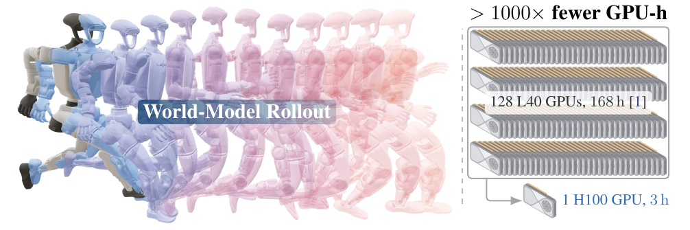
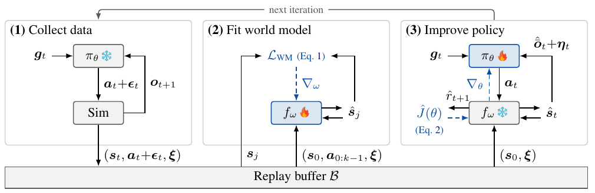
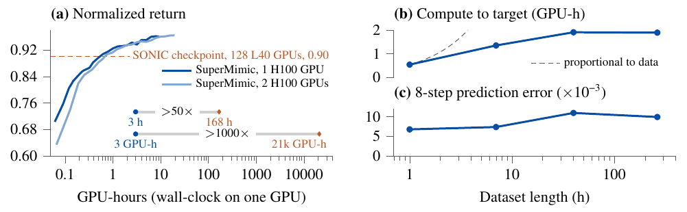
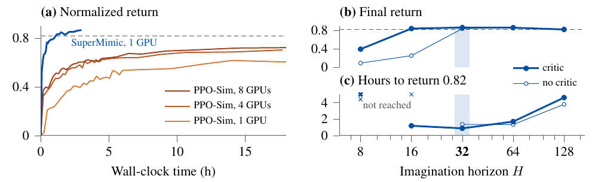
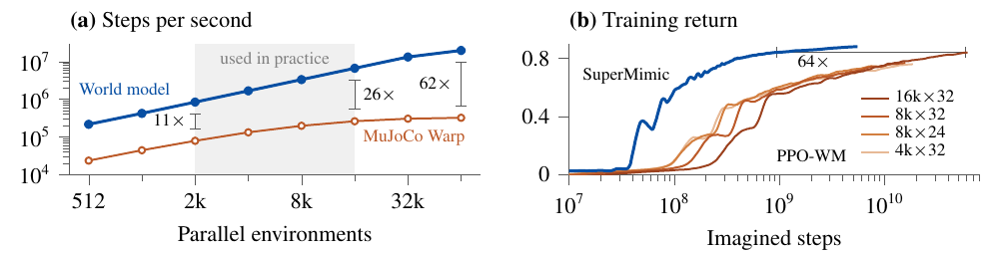
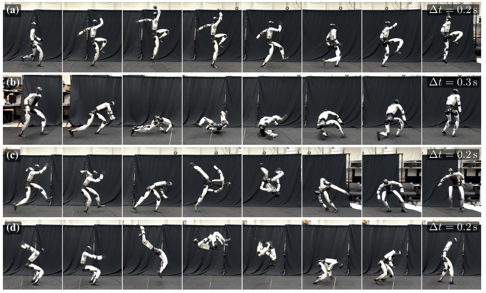
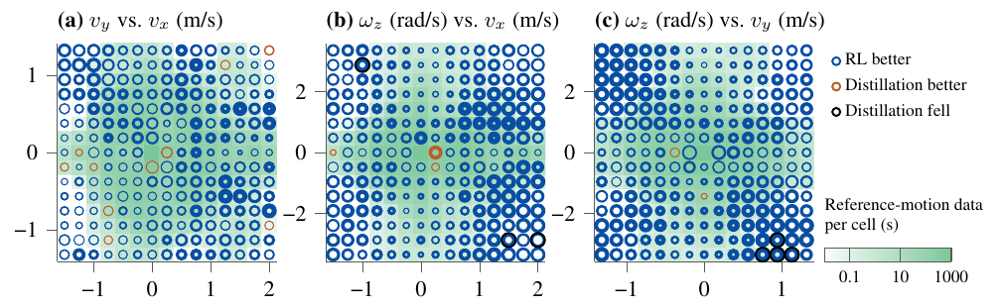
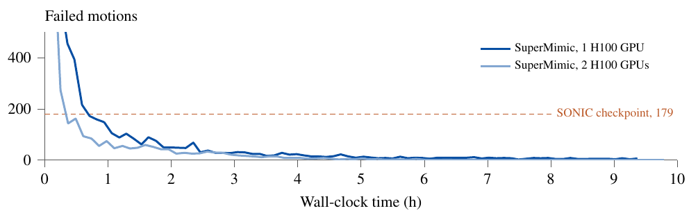

# SuperMimic：用一个可微分世界模型扩展人形机器人全身控制

**作者：** Qiayuan Liao、Yiyang Shao*、Junfeng Long*、Kevin Zakka、Roberto Horowitz、Pieter Abbeel†、Koushil Sreenath†

**单位：** 加州大学伯克利分校（UC Berkeley）

**项目主页：** https://supermimic.github.io

**原文：** arXiv:2610.28480v1 [cs.RO]，2026 年 10 月 20 日；第十届机器人学习会议（CoRL 2026），美国得克萨斯州奥斯汀。

*同等贡献；†共同指导。

> 译文说明：依据用户提供的 19 页 PDF 翻译，覆盖正文、致谢和附录 A–G。保留公式、图表、文献编号及原始实验数据；参考文献保留英文书目信息。图片保留原图，图注译为中文。为方便阅读重新分页，页码与原文不同。“我们”均指论文作者；原论文的方法和结论不等同于 Go2W 改编仓库或本项目的验证结果。

**图 1：** 学到的可微分世界模型用于训练人形机器人全身控制器；与使用集群算力的无模型强化学习相比，GPU 小时数减少超过 1000 倍（§4.1）。左：策略通过世界模型中的想象展开得到改进。右：SONIC [1] 使用 128 张 L40 GPU 训练 168 小时，本工作使用 1 张 H100 训练 3 小时。

## 摘要

跟踪大规模人体运动数据集，已成为实现通用、富有表现力的人形机器人全身控制的主要途径，但扩展到大量动作的代价很高。现有流程采用无模型强化学习：要么通过有损蒸馏合并针对各个动作训练的专用策略，要么动用集群规模算力，直接训练单一策略。SuperMimic 使用一个可微分世界模型描述所有动作共享的动力学，使学习成本能在各个动作之间分摊。该模型利用标准刚体模拟器记录的状态转移进行拟合。世界模型与跟踪策略在同一个循环中共同训练，通过对短时想象展开执行时间反向传播，为策略提供解析梯度。快速的想象展开和解析梯度提高了策略学习效率。

只用一张 GPU 训练 3 小时，SuperMimic 的回报就超过了一个使用 128 张 GPU 训练 7 天的先进运动跟踪基线。GPU 小时数减少超过 1000 倍；在包含 129,514 个动作的基准上，仅有 25 个动作失败，而基线有 179 个。使用两张 GPU 训练 9.8 小时后，SuperMimic 实现零失败。运动数据从 1 小时扩展到 264 小时时，世界模型预测误差保持稳定，达到目标回报所需的 GPU 小时数增长缓慢。策略能迁移到实体宇树 G1，执行多样化动作和杂技动作。SuperMimic 消除了扩展人形机器人全身控制时的算力瓶颈，使测量运动跟踪的规模规律成为可行的事情。

**关键词：** 人形机器人、全身控制、基于模型的强化学习。

## 1 引言

人形机器人有望在为人设计的环境中工作，但这要求全身控制器能覆盖多种人体动作，包括移动、舞蹈、下蹲和失衡恢复。基于物理的运动模仿通过训练强化学习策略，跟踪来自大型运动捕捉（mocap）数据集 [1] 的参考动作片段 [2]，来解决这个问题。现有系统扩展这一思路的方式包括：将许多片段专用专家蒸馏成一个控制器 [3]，或直接在大型动作库上训练通用策略 [1]。两种情况下，更多样的动作库都能带来能力更强的控制器。然而，随着动作覆盖范围扩大，两者的计算成本都会升高。例如，先进跟踪器 SONIC [1] 使用 128 张 GPU 训练约 168 小时，总计约 21,000 GPU 小时。

参考动作虽不相同，却共享同一个人形机器人的混合刚体动力学。无模型强化学习没有显式建模这一共享结构，而是不断从带噪声的模拟器展开中重新估计动作后果。因此，扩大动作规模就意味着扩大计算规模。

SuperMimic 使用一个从模拟器转移日志中学习的可微分世界模型，解决这种低效率。通过短时想象展开执行时间反向传播（BPTT），可以经由模型获得解析策略梯度，使一个动力学模型服务于整个动作捕捉库。梯度来自学到的模型，而非对模拟器本身求导，因此 SuperMimic 与刚体模拟器兼容，包括具有非光滑接触和不可微实现的模拟器。

在一张 GPU 上，SuperMimic 在 3 小时内超过 SONIC 已发布检查点的归一化回报，GPU 小时数减少超过 1000 倍（§4.1）。在 129,514 个动作的基准上，一张 GPU 训练 3 小时后失败 25 个动作，两张 GPU 训练 9.8 小时后没有失败；SONIC 已发布检查点失败 179 个动作（附录 F）。数据总时长增长 264 倍时，世界模型预测误差保持稳定，达到固定回报所需的计算量增长缓慢。学到的策略可以迁移到实体宇树 G1。在下游接口的初步研究中，用强化学习训练的速度编码器优于蒸馏基线。

**贡献。**

- **面向可部署人形控制的基于模型强化学习（MBRL）。** 我们证明，在一个长期主要采用无模型近端策略优化（PPO）[4] 的领域中，可以通过对学到的可微分世界模型执行 BPTT，训练全身跟踪策略，并将控制器迁移到实体宇树 G1。
- **算力不再是扩展的瓶颈。** SuperMimic 在单张 GPU 上超过集群规模 PPO 流程 SONIC 的回报，GPU 小时数减少超过 1000 倍（§4.1）。随着动作库扩大，训练成本增长缓慢，不需要庞大的 GPU 基础设施也能扩展全身控制。
- **分析性能提升的来源。** 我们识别出三项世界模型特性：数据时长增长 264 倍时预测误差保持稳定；展开速度比模拟器快 10 倍以上；解析梯度使策略用少约 64 倍的想象步数，达到 PPO 在世界模型上的最佳回报。
- **超越蒸馏的下游强化学习控制。** 初步研究表明，同一个世界模型可利用接口自身的任务奖励训练下游目标编码器。在速度指令上，这种编码器的跟踪精度优于蒸馏基线。

## 2 相关工作

**大规模、基于物理的运动跟踪。** 这类运动模仿学习在接触丰富的刚体动力学下复现参考动作。DeepMimic [2] 通过无模型强化学习展示了表现力丰富的角色技能；PHC [11] 将其扩展到大型动作集合，并实现稳健恢复。SONIC [1] 进一步展示：同时扩展运动数据、策略容量与训练算力，可以得到能迁移到人形硬件的通用控制器。这些结果表明，运动跟踪是广泛覆盖全身行为的实用途径。但训练大型跟踪器需要大量模拟器展开和计算。SuperMimic 学习所有动作共享的可微分动力学模型，使策略改进能够利用解析梯度，而非无模型展开估计，从而解决这一瓶颈。

**表 1：各方法在不同阶段的训练策略。** “模仿”“潜在表示”“下游”分别表示各阶段使用的训练策略；任务信号表示下游接口使用自身任务奖励（RL），还是参考跟踪信号（Distill）。原表合并单元格表示联合训练；相邻未合并单元格表示按顺序训练，每阶段开始前冻结上一阶段。下表用“联合”标明原表的合并关系。

| 方法 | 模仿 | 潜在表示 | 下游 | 任务信号 | 实体机器人 |
| --- | --- | --- | --- | --- | --- |
| NPMP [5] | SVG(0) | BC | SVG(0) | RL | 否 |
| ControlVAE [6] | MBRL（前两阶段联合） | 同左 | MBRL | RL | 否 |
| PhysicsVAE [7] | PPO | BC¹ | PPO | RL | 否 |
| PULSE [8] | PPO | DAgger | PPO | RL | 否 |
| MaskedMimic [9] | A2C | DAgger（后两阶段联合） | 同左 | Distill | 否 |
| BeyondMimic [3] | PPO | DAgger | CGD | Distill | 是 |
| SONIC [1] | PPO（三阶段联合） | 同左 | 同左 | Distill² | 是 |
| LATENT [10] | PPO | DAgger | PPO | RL | 是 |
| SuperMimic | MBRL（三阶段联合） | 同左 | 同左 | Distill / RL | 是 |

SVG(0)：随机价值梯度；BC：在固定专家展开数据上做离线行为克隆，与 DAgger 使用学生策略展开不同；CGD：分类器引导扩散；A2C：优势行动者–评价者；DAgger：数据集聚合。¹ 行为克隆还包含经由冻结的、学到的动力学模型计算的一步下一状态一致性项。² 目标编码器与跟踪器共同训练，使用运动跟踪奖励和潜在表示对齐损失，没有任务专用奖励。

**用于运动控制的可学习可微分动力学。** SuperTrack [12] 通过学到的模拟器可微分替代模型优化运动控制策略。ControlVAE [6] 联合学习动力学模型、潜在技能表示和生成式控制器；MoConVQ [13] 则把基于学习模型的训练扩展到数十小时数据上的离散运动表示。SuperDyno [14] 将可微分神经动力学扩展到数万个动作片段。这些方法证明，学习动力学和解析策略梯度能够有效扩展仿真角色控制。SuperMimic 将这一方向推进到单 GPU 训练大规模人形跟踪器，并实现仿真到真实部署：世界模型以模拟器上下文为条件，部署时的 actor 使用带噪本体观测和目标输入（§3.2）。我们评估模型精度、展开吞吐量和可微策略更新对训练效率的贡献，以及动作覆盖扩大时预测误差的变化（§4.1–4.2），并展示控制器的实体部署（§4.4）。

**基于模型的策略优化与机器人部署。** Dreamer [15]、DreamerV3 [16] 学习潜在动力学，在想象中训练 actor–critic；TD-MPC [17] 将短时规划与终端价值预测结合；DayDreamer [18] 展示了直接在实体机器人上学习世界模型。SHAC [19] 使用可微仿真进行短时域 actor–critic 更新，启发了 SuperMimic 利用 critic 自举的目标函数。解析梯度机器人控制也可以结合简化的可微替代模型与高保真前向模拟器，四足移动已有相应展示 [20]。SuperMimic 从模拟器转移中学习替代模型，通过短时想象展开反向传播，同时保留与标准刚体模拟器的兼容性。

RWM [21] 和 RWM-U [22] 证明，在学到的神经模拟器中训练的策略可以迁移到实体机器人。两者都在想象展开上用 PPO 优化策略；RWM-U 还采用带不确定性惩罚的离线优化。SuperMimic 则对回报沿学到的动力学求导来优化策略。RWM 和 RWM-U 先用其他策略生成的轨迹预训练世界模型；SuperMimic 在训练期间用自身策略采集的数据拟合世界模型。

**可复用运动表示与下游控制。** 可复用控制器将运动跟踪连接到下游目标接口（表 1）。NPMP [5]、PhysicsVAE [7] 从专家行为中学习潜在运动表示；PULSE [8]、LATENT [10] 利用学到的运动表示进行下游强化学习。MaskedMimic [9] 通过运动补全支持部分身体目标和多模态目标；BeyondMimic [3] 使用引导扩散进行目标跟随。SONIC [1] 使用跟踪奖励与潜在对齐损失，联合训练目标编码器和跟踪器。ControlVAE [6] 在冻结技能控制器的同时，通过学到的模型优化下游任务策略。SuperMimic 经由同一动力学模型，联合训练各目标专用编码器与共享解码器（附录 B）。目标接口既可以优化参考跟踪奖励，也可以优化自身任务奖励。我们的初步研究让速度接口与运动跟踪接口并行训练，分别考察两种目标（§4.5）。

## 3 方法

### 3.1 SuperMimic 训练循环

**图 2：SuperMimic 训练循环。** （1）当前策略 $\pi_\theta$ 在仿真中采集转移，放入固定容量的回放缓冲区 $\mathcal{B}$，新转移替换最旧转移。（2）从缓冲区采样 $k$ 步窗口，拟合可微分世界模型（§3.2）。（3）冻结世界模型，在其中想象展开 $H$ 步，经由 BPTT 改进策略；同阶段训练的 critic $V_\psi$ 对 $H$ 之后的回报进行自举（§3.3）。虚线箭头表示梯度，原图锁形和训练图标分别表示冻结与训练。符号包括目标 $g_t$（如参考动作）、动作 $a_t$、动作噪声 $\epsilon_t$、观测 $o_t$、状态 $s$、预测状态 $\hat{s}$ 和仿真上下文 $\xi$（域随机化参数）；$L_{\mathrm{WM}}$ 是世界模型损失，$\hat{\bar{o}}_t$ 是预测的无噪观测，$\eta_t$ 是传感器噪声，$\hat{r}_{t+1}$ 是预测奖励，$\hat{J}(\theta)$ 是策略目标。

SuperMimic 在多技能动作库上训练一个以目标为条件的全身控制器，并支持多种目标接口。它利用可微分世界模型捕捉人形机器人的共享动力学，通过短时想象展开改进策略。在同一个循环中交替执行三个阶段（图 2）：首先，当前策略把模拟器转移采集到回放缓冲区；其次，在短回放窗口上拟合可微分世界模型；最后，按照 Dyna [23,24] 的方式，从回放状态开始展开，在冻结的世界模型中对想象回报反向传播以改进策略。缓冲区、模型、策略在整个训练过程中持续更新，因此动力学学习与控制共同改进，而不是分成独立阶段（算法 A.1，附录 D）。过去策略产生的转移仍然可以用于拟合世界模型，因为动力学不依赖于采集数据的策略。

将目标条件部分可观测马尔可夫决策过程（POMDP）记为 $\mathcal{M}$，简记其状态为 $s_t$、目标为 $g_t$、动作为 $a_t$。状态给出本体观测 $o_t$ 以及终止信号 $d_t$；若状态为终止状态，则 $d_t=1$。在状态 $s_t$ 执行动作后，获得奖励 $r_{t+1}$ 和下一状态 $s_{t+1}$。策略是确定性的：$a_t=\pi_\theta(o_t,g_t)$，动作参数化归一化的关节设定值；运动跟踪的目标从参考动作中读取。

采集数据时，模拟器执行带噪动作 $a_t+\epsilon_t$，其中 $\epsilon_t\sim\rho_\epsilon$；回放缓冲区存储实际执行的带噪动作。噪声扩大世界模型拟合时覆盖的动作范围，仅服务于模型拟合，是可选项。回报使用软存活权重：$c_0=1$、$c_{t+1}=c_t(1-d_{t+1})$，从而有：

$$
J(\theta)=\mathbb{E}\left[\sum_{t\geq0}\gamma^t c_t r_{t+1}\right],\quad \gamma\in[0,1).
$$

模拟器记录硬终止，而学习模型预测终止概率 $\hat{d}_t\in[0,1]$，使想象展开中的存活权重保持可微。帽符号表示模拟器量在世界模型中的对应量。我们还将观测分解为 $o_t=\bar{o}_t+\eta_t$，其中 $\bar{o}_t$ 为无噪观测，已知分布的观测噪声 $\eta_t\sim\rho_\eta$ 在世界模型之外采样。完整空间和奖励见附录 A。

默认接口为完整参考动作跟踪。速度等其他目标接口共享同一个学到的动力学模型，并与运动跟踪联合训练（附录 B）。

### 3.2 学习可微分世界模型

模拟器中的关节连接多刚体动力学是已知的，但模拟器不必提供梯度。因此，SuperMimic 学习一个可微分替代模型来获得策略梯度：该模型为 §3.3 的 BPTT 更新提供预测和雅可比矩阵。得到的解析策略梯度，是仿真期望回报之替代目标的梯度。由于模拟器随机性的来源已知，世界模型仍然是确定性的：它以每回合仿真上下文 $\xi$（摩擦、标定偏移、躯干质心）为条件，并预测无噪观测。

世界模型包含学到的动力学模型，以及奖励、观测、终止分支；各分支可以通过学习得到，也可以解析计算：

$$
\hat{s}_{t+1}=f_\omega(\hat{s}_t,a_t,\xi),\qquad \hat{r}_{t+1}=r_\omega(\hat{s}_t,a_t,g_t),
$$

$$
\hat{\bar{o}}_t=g_\omega(\hat{s}_t,\xi),\qquad \hat{d}_t=d_\omega(\hat{s}_t,g_t).
$$

使用 $k=8$ 步自回归回放窗口拟合权重 $\omega$。展开从记录状态 $\hat{s}_0=s_0$ 开始，输入记录动作，并最小化：

$$
L_{\mathrm{WM}}(\omega)=\mathbb{E}_{\mathcal{B}}\sum_{j=1}^{k}\left[\|\hat{s}_j-s_j\|^2+(\hat{r}_j-r_j)^2+\|\hat{\bar{o}}_j-\bar{o}_j\|^2+\mathrm{BCE}(\hat{d}_j,d_j)\right].\tag{1}
$$

解析计算的分支不设置相应损失项。这里，$r_j$ 为模拟器奖励，$d_j\in\{0,1\}$ 为模拟器终止标签，BCE 表示二元交叉熵。

### 3.3 通过世界模型学习策略

每次策略更新时，固定世界模型权重，在 $H=32$ 步想象展开上优化策略与 critic。Critic 估计第 $H$ 步之后的回报，因此模型只需在这 $H$ 步之内准确。想象时域长于拟合模型使用的 $k$ 步回放窗口。实践中，学习模型在任意长展开中仍保持稳定，因为 $k$ 步自回归拟合训练它修正自身预测误差。

每条想象轨迹从回放状态 $s_0\sim\rho_0$ 及其记录的仿真上下文开始。每步，模型输出无噪观测，我们重新加入传感器噪声，再由策略选择动作：$a_t=\pi_\theta(\hat{\bar{o}}_t+\eta_t,g_t)$，$\eta_t\sim\rho_\eta$。策略的想象展开目标为：

$$
\hat{J}(\theta)=\mathbb{E}_{s_0\sim\rho_0,\,\pi_\theta}\left[\sum_{t=0}^{H-1}\gamma^t\hat{c}_t\hat{r}_{t+1}+\gamma^H\hat{c}_H V_\psi(\hat{s}_H,g_H,\xi)\right].\tag{2}
$$

运动跟踪采用 BeyondMimic [3] 的奖励，移除其中的自碰撞惩罚（附录 A）。

由于世界模型可微，BPTT 可以通过模型相对于预测状态和动作的雅可比矩阵，在 $H$ 步想象轨迹上计算一阶梯度 $\nabla_\theta\hat{J}$。相比之下，PPO 把动力学当作黑箱：将随机策略的得分函数 $\nabla_\theta\log\pi_\theta$，按采样动作的优势加权，得到似然比估计。BPTT 则直接对回报相对于每个动作求导，因此在短时域内，梯度方差低得多。

Critic 使用仅由想象转移计算的广义优势估计（GAE）回报 [25] 拟合；目标沿时间反向递推：

$$
L_V(\psi)=\mathbb{E}\sum_{t=0}^{H-1}(V_t-\hat{R}_t)^2,\qquad \hat{R}_t=\hat{r}_{t+1}+\gamma(1-\hat{d}_{t+1})[(1-\lambda)V_{t+1}+\lambda\hat{R}_{t+1}].\tag{3}
$$

其中 $V_t=V_\psi(\hat{s}_t,g_t,\xi)$；递推从 $\hat{R}_H=V_H$ 开始，即 critic 对想象时域之外回报的估计。每条轨迹只计算一次目标，在拟合 critic 权重时目标保持固定。

策略和 critic 的更新共同构成短时域 actor–critic，其思路类似通过可微模拟器反向传播的 SHAC [19]。SuperMimic 用存活权重替代 SHAC 的硬回合终止，且 critic 不采用指数移动平均目标网络。先前用解析梯度训练的运动跟踪器往往省略 critic，只优化 $H$ 步奖励之和 [12,6]。不使用 critic，也能达到相近的标称跟踪回报，但没有自举的目标更短视。在扰动后的恢复或平衡奖励位于想象窗口之外时，critic 尤为重要（§4.3）。

## 4 实验结果

我们展示 SuperMimic 相对于 PPO 流程更有利的扩展表现，识别这一表现背后的世界模型特性，在实体宇树 G1 上验证迁移，并报告下游目标接口的初步研究。模拟器采用 MuJoCo 的 GPU 实现 MuJoCo Warp [26]。报告的所有计算成本，均在 Lambda 按需实例的 NVIDIA H100（80 GB SXM5）上测量。我们运行了多个随机种子，发现训练十分稳定，将其归因于运动跟踪每一步都能提供稠密奖励。因此图中没有报告随机种子差异。归一化回报（下文简称回报）为完整回合每步奖励的不折扣总和，除以该总和可能达到的最大值。提前终止的策略因此会得低分。

### 4.1 用少得多的 GPU 小时数达到 SONIC 级跟踪水平

我们与已发表的 PPO 流程 SONIC 比较，其训练使用 128 张 GPU 的集群。两种方法都建立在 BeyondMimic [3] 的运动跟踪表述上，因此 SONIC 是现有已发表方法中最接近的比较对象。单张 GPU 训练 3 小时之内，SuperMimic 超过 SONIC 已发布检查点的归一化回报（图 3(a)）。在 129,514 个动作的共同基准上，失败动作也更少：单 GPU 训练 3 小时后为 25 个，双 GPU 训练 9.8 小时后为 0 个，SONIC 已发布检查点则为 179 个（附录 F）。

3 小时是保守表述：从这一时刻起，在回报与失败动作数两项上，每个检查点领先 SONIC 的幅度，都至少达到 SONIC 与 SuperMimic 最佳结果差距的一半。因此，SuperMimic 的实际耗时减少超过 50 倍，GPU 小时数减少超过 1000 倍。

**计算成本核算。** 比值比较的是 SONIC 报告的 128 张 NVIDIA L40 训练 7 天（约 21,000 GPU 小时），以及 SuperMimic 在单张 NVIDIA H100 上训练 3 小时；后者在这段时间内超过 SONIC 已发布检查点的回报。实际耗时比约为 56 倍（>50 倍），GPU 小时数比约为 7200 倍（>1000 倍）。3 小时包含完整训练循环；检查点评估在训练后执行，不计入。SuperMimic 使用 BONES-SEED [27] 中 264.56 小时动作，这是 SONIC 数据的公开子集，比 SONIC 的 611 小时少约 2.3 倍。GPU 型号也不同：按峰值吞吐量，H100 的 FP32 性能为 L40 的 0.74 倍，张量核心性能为其 5.5 倍；两次训练实际利用峰值性能的程度未知。然而，2.3 倍的数据差异与最多 5.5 倍的 GPU 峰值吞吐量差异，不能解释 1000 倍的 GPU 小时数差距。

图 4(a) 给出 LAFAN1 [28] 上的受控比较。基线 PPO-Sim 直接在模拟器中训练 PPO；它与 SuperMimic 使用相同动作、观测、奖励、终止、域随机化、actor 和 critic 网络大小及评估流程。PPO-Sim 使用 BeyondMimic [3] 的 PPO 超参数，每 GPU 8192 个并行环境，是 SuperMimic 的两倍。PPO-Sim 从模拟器采样展开中估计策略梯度；SuperMimic 则通过世界模型展开，对想象回报反向传播。SuperMimic 在单 GPU 上 1.2 小时内达到评估回报 0.82；PPO-Sim 在 18 小时预算内仍未达到。其最终回报在单 GPU、四 GPU、八 GPU 时分别为 0.60、0.70、0.72，因此从四张增至八张几乎没有帮助。

图 3(b,c) 显示，随着数据时长增长，SuperMimic 达到目标回报的 GPU 小时数增长缓慢，同一组实验中的世界模型预测误差保持稳定。§4.2 将两项趋势归因于：一个世界模型复用了不同动作之间共享的动力学。

**图 3：SuperMimic 用少得多的 GPU 小时数超过 SONIC 跟踪回报。** (a) 单张与两张 H100 上训练的 SuperMimic 都超过 SONIC 已发布检查点（虚线），三者均在同一组 129,514 个动作、264 小时的基准上评分。两行预算对比用圆点表示 SuperMimic、菱形表示 SONIC：实际耗时减少超过 50 倍，GPU 小时数减少超过 1000 倍。(b,c) 在同一组数据时长扫描实验中，达到目标回报的 GPU 小时数增长缓慢；数据从 1 小时增至 264 小时时，模型八步预测误差保持在 0.007–0.011，符合一个世界模型复用跨动作身体与接触动力学的解释。误差仅统计状态，按预定义标称误差归一化，在策略展开上在线测量。

**图 4：在受控比较中，SuperMimic 比 PPO-Sim 更快达到更高回报；critic 允许更短想象时域。** 所有实验使用 LAFAN1 的 40 个片段，共 2.45 小时。(a) SuperMimic 用一张 GPU 经由世界模型对想象回报反向传播；PPO-Sim 在模拟器中使用 1、4、8 张 GPU 训练。曲线上每个点为保存的检查点在全部 40 个片段上的评分。(b,c) 在不同想象时域下，有、无 critic 的最终训练回报及训练回报达到 0.82 的实际小时数。(a,b) 虚线标记目标 0.82。训练回报来自训练回合，其初始状态按照基于回报的重置采样（附录 D.1）选择，并随训练改变，因此不同于 (a) 的检查点评分。(c) 叉号表示没有达到 0.82：$H=8$ 时两种变体均失败，$H=16$ 时无 critic 变体失败；阴影表示默认 $H=32$。

### 4.2 学到的世界模型的特性

这些结果依赖世界模型的三项特性：动作库扩大时仍保持精度；展开速度快；可微分。

**一个模型服务整个动作库。** 图 3(c) 中，数据从 1 小时增至 264 小时时，模型八步预测误差保持在 0.007–0.011。所有动作都由同一个人形机器人执行，因此新增片段提供更多关于共享身体和接触动力学的证据，而非要求新增模型容量。这与达到目标回报所需计算量缓慢增长的结果一致（§4.1）。

**想象加速展开。** 策略优化中，展开速度决定更新成本。图 5(a) 显示，在实际使用的批大小下，世界模型比 MuJoCo Warp 快 10 倍以上；64k 个并行环境下，最高达 62 倍。

**一阶梯度需要更少想象步数。** 图 5(b) 通过机制消融单独考察一阶策略更新的优势：SuperMimic 用少约 64 倍的想象步数达到 PPO-WM 的最佳回报，因此收益不只是展开更快。

**图 5：想象展开快速且可微分。** (a) 在 H100 上，实际使用的批大小范围（阴影，2k–16k 个并行环境）内，世界模型比 MuJoCo Warp 快 10 倍以上；64k 时差距扩大到 62 倍，此时 MuJoCo Warp 吞吐量已趋平。一步指一个 50 Hz 控制步，MuJoCo Warp 用四个 5 ms 子步计算；世界模型使用 SuperMimic 训练时的 TF32 精度。(b) 在 LAFAN1 [28] 的步行、跑步、冲刺动作上，采用自身 actor–critic 更新的 SuperMimic，用少约 64 倍的想象步数达到 PPO 在世界模型展开上训练（PPO-WM）的最佳训练回报。PPO-WM 比较四种“并行轨迹数×每条轨迹步数”配置：4k×32、8k×24、8k×32、16k×32，最后一种最好。每条曲线是在想象步数对数轴上 ±0.05 个十倍区间内计算的居中移动平均。

### 4.3 Critic 允许更短时域并支持受推恢复

图 4(b,c) 扫描有、无 critic 的想象时域。不使用 critic 时，$H\leq16$ 的训练失败；使用 critic 时，$H=16$ 可以达到无 critic 的 $H=32$ 水平，$H=32$ 最快达到回报 0.82。将时域从 64 增到 128，达到该回报的时间几乎增加到三倍，最终回报也下降；128 是 H100 显存所能容纳的最长时域。

即使回报相当，critic 仍会改变行为。在仿真中保持静态 T 字姿态，并施加 0.5–4 m/s 的速度推扰时，有 critic 的策略在 0.5–2.4 秒内稳定；没有 critic 的策略始终无法稳定，0.5 m/s 时仍不断踉跄，4 m/s 时摔倒。

### 4.4 实体机器人迁移

单一通用运动跟踪器无需针对每个动作调参，即可部署于实体宇树 G1（图 6）。四种动作涵盖移动（跨步跳）、躯干和四肢接触地面的全身动作（侧滚），以及杂技动作（90° 翻转、原地 360° 翻转）。

**图 6：通过学习世界模型训练的单一通用运动跟踪器，迁移到实体宇树 G1。** (a) 跨步跳，连续画面间隔 0.2 s；(b) 侧滚，0.3 s；(c) 90° 翻转，0.2 s；(d) 原地 360° 翻转，0.2 s。

### 4.5 下游任务：强化学习编码器与蒸馏基线

SuperMimic 将下游目标编码器与运动跟踪接口联合训练，共享一个解码器和世界模型（附录 B）。下游接口研究是初步的。我们通过世界模型，用速度跟踪奖励训练一个速度编码器；与其比较的蒸馏基线，也使用速度编码器，但采用运动跟踪奖励，指令从参考动作中读取。

图 7 在速度空间内的 672 个阶跃响应上评估二者（附录 G）。强化学习编码器在 650 个响应上稳态误差更低，蒸馏编码器在 15 个上更低。只有蒸馏编码器发生摔倒，出现在动作库几乎没有数据的七个快速转弯指令上。

**图 7：使用强化学习速度编码器的策略，比蒸馏基线更准确地跟踪阶跃指令。** 三个子图分别为指令空间中第三分量固定为零的平面：$(v_y,v_x)$、$(\omega_z,v_x)$、$(\omega_z,v_y)$。每个圆环对应一条指令。外圆面积与两种策略中较大的相对稳态误差成正比，内孔面积与较小误差成正比，颜色表示较好的策略。原图图例依次为“RL 更好”“蒸馏更好”“蒸馏摔倒”；背景表示每个网格中参考动作数据的秒数。详见附录 G。

## 5 结论

SuperMimic 消除了扩展人形机器人全身控制时的算力瓶颈。一个学到的可微分世界模型捕捉所有动作共享的动力学，通过时间反向传播，将整个数据集的学习成本分摊到同一个策略。策略在单张 GPU 上训练，超过使用 128 张 GPU 集群训练的策略回报，并能迁移到实体宇树 G1。在受控的数据时长扫描中，其训练成本增长缓慢。同一个模型还能直接根据下游速度接口自身的任务奖励训练该接口。每次实验只需要一张 GPU，测量运动跟踪的规模规律现在变得负担得起。

## 6 局限与未来工作

- **对多接口训练研究不足。** 我们让速度编码器与运动跟踪器并行训练，但速度跟踪奖励只更新速度编码器，不更新共享解码器（附录 B）。因此，并行训练与先训练运动跟踪器、再训练速度编码器是等价的，并行可能并非必要。当速度跟踪奖励也更新解码器时，并行训练是否有帮助，尚未验证。
- **动力学数据仅来自模拟器。** 世界模型只从模拟器转移中学习。真实机器人数据可以改进模型，其可微性也可以支持系统辨识。
- **没有地形或物体交互。** SuperMimic 只在平地训练，扩展到地形与物体交互仍在进行中。

## 致谢

感谢 Bike Zhang、Sangli Teng、Nima Rahmanian、Songbo Hu 提供有益讨论并协助实验。本工作得到 Komatsu、BAIR Center for Humanoid Intelligence、Apple、RAI Institute 的部分资助。感谢 Lambda 为项目赞助计算资源。运动数据由 Bones Studio（https://bones.studio/）提供。Pieter Abbeel、Koushil Sreenath 同时担任加州大学伯克利分校教授和 Amazon Scholars。本文描述的工作在加州大学伯克利分校完成，与 Amazon 无关。

## 参考文献

书目信息按原文保留，位于文末，便于先连续阅读附录；正文及附录引用编号保持不变。

## 附录 A 具体设定：观测、动作、奖励与仿真上下文

本附录具体定义 §3.1 POMDP 的共享空间。运动跟踪接口遵循 BeyondMimic [3] 的表述，修改处在下文注明。

**观测。** 本体观测包括相对默认姿态的关节位置 $q-q^0$、关节速度 $\dot{q}$、IMU 给出的基座角速度、基座坐标系投影重力及上一步动作（表 A.1）。策略接收最近 10 帧观测。

**表 A.1：本体观测。** 噪声列表示每个维度独立的传感器噪声 $\eta_t\sim\rho_\eta$。

| 观测项 | 维度 | 噪声分布 | 单位 |
| --- | --- | --- | --- |
| 关节位置 $q-q^0$ | 29 | $U[-0.01,0.01]$ | rad |
| 关节速度 $\dot{q}$ | 29 | $U[-0.5,0.5]$ | rad/s |
| 基座角速度（IMU） | 3 | $U[-0.2,0.2]$ | rad/s |
| 投影重力 | 3 | $U[-0.05,0.05]$ | 无 |
| 上一步动作 $a_{t-1}$ | 29 | 无 | 无 |

**目标。** 运动跟踪接口从参考动作读取目标。与 BeyondMimic [3] 的单帧目标相比，我们让编码器以未来 $K=10$ 帧参考序列为条件。其他目标接口将目标替换为相应的指令表示，例如目标速度指令（附录 B）。

**动作。** 动作映射为围绕默认姿态的关节设定值 $q^{\mathrm{sp}}=\alpha a_t+q^0$。与 BeyondMimic 一样，较低的 PD 增益使该设定值成为关节力矩的代理，而非期望位置。

**奖励。** 采用 BeyondMimic 的运动跟踪奖励（表 A.2），移除自碰撞惩罚。该惩罚原本用于防止随机策略利用奖励漏洞：当参考动作让两个身体部位接近但不接触时，将它们压在一起能够抑制动作噪声，从而提高速度跟踪奖励。我们的策略在想象展开中是确定性的（§3.3），因此这种利用方式无法带来收益，相应项不再必要。关节限位惩罚权重由 −10 降至 −2。

**终止。** 根部相对参考的高度或倾斜偏差超过阈值时终止回合：$|e_{p,z}|>0.25$ m 或 $e_{\mathrm{tilt}}>0.8$。倾斜误差是重力方向分别在参考根部和机器人根部（骨盆）坐标系中表达时，其 z 分量差的绝对值。参考为直立时，约倾斜 78° 会达到 0.8。与 BeyondMimic 不同，我们不因末端执行器偏离而终止。

**仿真上下文和域随机化。** 每回合上下文收集输入世界模型的域随机化参数（§3.2），见表 A.3。我们省略 BeyondMimic 的根部速度扰动，因为这种推扰引入确定性世界模型无法捕捉的状态不连续；我们发现，仅随机化物理参数就足以迁移到硬件。

**表 A.2：运动跟踪接口奖励。** 遵循 BeyondMimic [3]，删除自碰撞惩罚，关节限位权重从 −10 改为 −2。$\mathcal{T}$ 为被跟踪身体部位集合。

| 奖励项 | 表达式 | 权重 |
| --- | --- | --- |
| 身体位置 | $\exp[-\frac{1}{|\mathcal{T}|}\sum_{b\in\mathcal{T}}\|p_b^{\mathrm{des}}-p_b\|^2/0.3^2]$ | 1.0 |
| 身体朝向 | $\exp[-\frac{1}{|\mathcal{T}|}\sum_{b\in\mathcal{T}}\|\log(R_b^{\mathrm{des}}R_b^\top)\|^2/0.4^2]$ | 1.0 |
| 身体线速度 | $\exp[-\frac{1}{|\mathcal{T}|}\sum_{b\in\mathcal{T}}\|v_b^{\mathrm{des}}-v_b\|^2/1.0^2]$ | 1.0 |
| 身体角速度 | $\exp[-\frac{1}{|\mathcal{T}|}\sum_{b\in\mathcal{T}}\|\omega_b^{\mathrm{des}}-\omega_b\|^2/3.14^2]$ | 1.0 |
| 根部位置 | $\exp[-\|p_{\mathrm{root}}^{\mathrm{des}}-p_{\mathrm{root}}\|^2/0.3^2]$ | 0.5 |
| 根部朝向 | $\exp[-\|\log(R_{\mathrm{root}}^{\mathrm{des}}R_{\mathrm{root}}^\top)\|^2/0.4^2]$ | 0.5 |
| 动作平滑 | $\|a_t-a_{t-1}\|^2$ | −0.1 |
| 关节限位 | $\sum_j[\max(0,q_j-q_j^{\max})+\max(0,q_j^{\min}-q_j)]$ | −2 |

**表 A.3：构成仿真上下文的域随机化参数。** 基于 BeyondMimic [3]，移除根部速度扰动。$U$ 表示均匀分布。

| 域随机化项 | 采样分布 |
| --- | --- |
| 摩擦系数 | $\mu\sim U[0.3,1.2]$ |
| 关节标定偏移（rad） | $\Delta q_j^0\sim U[-0.01,0.01]$ |
| 躯干质心偏移（m） | $\Delta x\sim U[-0.025,0.025]$，$\Delta y,\Delta z\sim U[-0.05,0.05]$ |

## 附录 B 跨目标接口联合训练

§3 的目标来自完整参考动作。下游目标接口只部分指定动作，或使用另一种形式指定动作。身体物理规律共享，因此同一个动力学模型能训练多个目标接口。为每个接口定义一个 POMDP $\mathcal{M}_i$，例如完整参考动作目标、速度指令、末端位姿或 SMPL 身体姿态目标；每个接口拥有自己的目标空间 $\mathcal{G}_i$、奖励 $r_i$、终止 $d_i$ 和 critic $V_{\psi_i}$。单一策略网络使用各接口专用目标编码器和共享解码器：

$$
z=\mathrm{enc}_{\theta,i}(g)\in\mathcal{Z},\qquad a=\mathrm{dec}_\theta(z,o),\qquad g\in\mathcal{G}_i.\tag{A.1}
$$

训练优化扩展目标 $\max_\theta\mathbb{E}_{i\sim p(\mathcal{I})}[\hat{J}_i(\theta)]$，其中 $p(\mathcal{I})$ 是接口集合上的分布。因此每个接口拥有自己的策略 $\pi_i(o,g):=\mathrm{dec}_\theta(\mathrm{enc}_{\theta,i}(g),o)$；速度编码器还接收观测历史特征（表 A.4）。每个接口的目标均为公式 (2)，只是替换为对应策略、POMDP 的奖励与终止，以及该接口的 critic。所有接口都通过同一动力学模型训练，不会为每个接口重新训练动力学模型。

下游接口采用蒸馏还是强化学习，取决于奖励。蒸馏使用运动跟踪奖励（§3.3），指令从参考动作读取；奖励梯度让接口根据该指令复现参考动作。强化学习则直接通过世界模型优化接口自己的任务奖励，例如速度跟踪。

在下游接口的展开上，回报梯度通过共享解码器传到对应编码器，但对解码器权重停止梯度；解码器仍由运动跟踪目标训练。§4.5 的强化学习速度编码器，在参考指令展开上还使用潜在对齐损失，使其潜在表示接近运动编码器的表示（附录 G）。

## 附录 C 网络结构

表 A.4 列出 §3.2 的世界模型动力学网络，以及附录 B 的策略和 critic 网络。

**表 A.4：世界模型、策略和 critic 网络。** MLP 为多层感知机，括号列出各隐藏层宽度。潜在表示 $z$ 为 32 维，经 tanh 限幅。

| 网络 | 输入 | 输出 | 结构 |
| --- | --- | --- | --- |
| 动力学 $f_\omega$ | 预测状态、动作、仿真上下文 | 下一预测状态 | MLP (2048, 2048, 2048) |
| 运动编码器 | 未来 10 帧参考动作 | 潜在表示 $z$ | MLP (2048, 1024, 512, 256) |
| 速度编码器（附录 G） | 归一化指令 $(v_x,v_y,\omega_z)$，最近 10 帧观测的特征 | 潜在表示 $z$ | MLP (256, 256) |
| 共享解码器 | $z$，最近 10 帧观测 | 动作 $a_t$ | MLP (2048, 1024, 512, 256) |
| 每接口 critic | 预测状态、目标、仿真上下文 | 标量 | MLP (256, 128)，每个接口各一个 |

**算法 A.1：SuperMimic 训练。** 世界模型权重和策略权重每轮都更新；只在策略反向传播内部固定世界模型权重。对于下游接口，目标仅更新其编码器。

前提：世界模型、跨接口共享策略、回放缓冲区。

1. 对每一轮迭代执行以下操作。
2. **采集：** 在仿真中用策略加动作噪声展开；将转移放入缓冲区，替换最旧数据。
3. 根据回报采样重置起点（附录 D.1）。
4. **拟合世界模型：** 从缓冲区采样记录的 $k$ 步窗口；输入记录动作，让模型自回归展开，并执行 $\omega\leftarrow\omega-\alpha_\omega\nabla_\omega L_{\mathrm{WM}}$（公式 1）。
5. **改进策略：** 采样接口 $i\sim p(\mathcal{I})$ 和缓冲区起始状态。
6. 经由固定的世界模型，使用当前策略想象展开 $H$ 步：$\hat{s}_{t+1}=f_\omega(\hat{s}_t,\pi_i(\hat{\bar{o}}_t+\eta_t,g_t),\xi)$。
7. 更新 $\theta\leftarrow\theta+\alpha_\theta\nabla_\theta\hat{J}_i$（公式 2）；使用通过世界模型的解析梯度和对应 critic。
8. 用想象展开的 GAE 目标拟合对应 critic（公式 3）。
9. 结束本轮循环。

## 附录 D 训练循环与超参数

### D.1 算法

算法 A.1 总结 §3.1 的训练循环，三个阶段与图 2 一一对应。

**基于回报的重置采样。** 模拟器回合从动作库中的位置重置，优先选择当前策略回报较低的位置。动作时间轴划分为 1 s 区间，每个区间 $b$ 维护从该位置开始的折扣回报运行估计 $G_b$，由策略自身展开更新。重置混合三个分布：50% 在区间上均匀采样，40% 按 $\mathrm{softmax}_b(-25G_b/G_{\max})$ 采样，10% 按每个区间过去的 softmax 权重比例采样。$G_{\max}$ 为最大可达折扣回报。这样，困难动作即使学会后仍保留一定练习机会。

### D.2 超参数

表 A.5 给出超参数；存在差异时，分别列出表 A.8 中单 GPU 与双 GPU 实验的取值。

**表 A.5：SuperMimic 超参数。**

| 类别 | 超参数 | 取值 |
| --- | --- | --- |
| 世界模型 | 窗口长度 $k$ | 8 |
| 世界模型 | 优化器 | Adam |
| 世界模型 | 学习率 $\alpha_\omega$ | 单 GPU：$2\times10^{-4}$；双 GPU：$\sqrt{2}\times2\times10^{-4}$ |
| 世界模型 | 批大小 | 每次更新 10 批，每批 2048 个窗口 |
| 世界模型 | 梯度裁剪 | 全局范数 1.0 |
| 想象与策略 | 想象时域 $H$ | 32 |
| 想象与策略 | 优化器 | Adam，$\beta=(0.9,0.95)$ |
| 想象与策略 | 学习率 $\alpha_\theta$ | 与世界模型相同 |
| 想象与策略 | 批大小 | 每次更新 4096 条想象轨迹 |
| 想象与策略 | 梯度裁剪 | 先全局范数 1.0，再逐元素裁剪至 0.1 |
| 想象与策略 | 折扣因子 $\gamma$ | 0.99 |
| 想象与策略 | 传感器噪声 | 表 A.1 |
| Critic | GAE 参数 $\lambda$ | 0.95 |
| Critic | 优化器 | Adam |
| Critic | 学习率 | 与世界模型相同 |
| Critic | 梯度裁剪 | 全局范数 1.0 |
| Critic | 每次更新拟合 | 5 个 epoch，每个含 4 个打乱的小批次 |
| 数据采集 | 每 GPU 模拟器环境数 | 4096 |
| 数据采集 | 动作噪声 | 每个动作维度 $\mathcal{N}(0,0.1^2)$ |
| 数据采集 | 回放容量 | 每环境 1000 步 |
| 调度 | 更新与数据之比（UTD） | 0.4 |
| 调度 | 每次世界模型更新的策略更新次数 | 1 |
| 调度 | 学习率计划 | 前 250,000 轮余弦衰减至 0.03 倍，此后固定 |
| 调度 | 训练长度 | 320,000 轮 |
| 调度 | 多 GPU | 数据并行，GPU 间梯度取平均 |

**表 A.6：训练 RL 速度编码器的奖励与终止。**

| 奖励项 | 表达式 | 权重 |
| --- | --- | --- |
| 线速度跟踪 | $\exp[-\|v_{xy}-v_{xy}^{\mathrm{cmd}}\|^2/0.5^2]$ | 2.0 |
| 偏航角速度跟踪 | $\exp[-(\omega_z-\omega_z^{\mathrm{cmd}})^2/0.5]$ | 2.0 |
| 动作平滑 | $\|a_t-a_{t-1}\|^2$ | −0.3 |
| 关节限位 | $\sum_j[\max(0,q_j-q_j^{\max})+\max(0,q_j^{\min}-q_j)]$ | −2 |
| 躯干侧倾 | $\sin^2\phi_{\mathrm{torso}}$ | −4 |
| 躯干滚转、俯仰角速度 | $\omega_{\mathrm{roll}}^2+\omega_{\mathrm{pitch}}^2$ | −0.05 |

跌倒终止条件为 $h_{\mathrm{root}}<0.35$ m，或 $1+u_z>0.7$。

这里，平面根部速度在仅考虑偏航的航向坐标系中表达，偏航角速度在世界坐标系中表达；两者与对应目标构成指令。$\phi_{\mathrm{torso}}$ 是躯干 z 轴的侧倾角，**不惩罚前倾**。躯干滚转和俯仰角速度也在航向坐标系表达。根部高度记为 $h_{\mathrm{root}}$，$u_z$ 是根部坐标系中单位重力方向的 z 分量；因此，直立时 $1+u_z=0$，倒置时为 2，约倾斜 73° 触发条件。本表与表 A.2 的每个奖励项都乘控制周期 $\Delta t=0.02$ s。

## 附录 E 运动数据筛选

我们使用公开的、重定向到 G1 的 BONES-SEED 动作集 [27] 训练。原始发布版包含 142,220 个片段；其中许多与机器人无法使用的地形或物体交互，例如楼梯、箱子、梯子、椅子，或含有重定向伪影，使它们无法由平地上独立站立的人形机器人实现。我们分两轮删除这些数据，保留 129,514 个片段（表 A.7）。

**表 A.7：筛选前后 BONES-SEED 动作片段数。**

| 阶段 | 片段数 |
| --- | --- |
| 原始 BONES-SEED（G1 重定向） | 142,220 |
| 名称筛选后 | 129,667 |
| 可行性筛选后 | 129,514 |

**名称筛选。** 每个片段按动作命名。如果名称包含与不可使用地形或物体接触的词语，则删除，例如 stair、ladder、box、chair、sit、climb、jump off 50cm、look over fence。这一轮基于 SONIC 已发布数据处理代码 [1] 的关键词列表，并补充少数遗漏词，共删除 12,553 个片段。

**可行性筛选。** 名称筛选会漏掉名称没有揭示问题的片段，例如走上箱子的动作。我们对每个动作执行 MuJoCo 前向运动学，根据身体连杆与足部碰撞几何的轨迹标记问题。地面为 $z=0$，定义时刻最低身体连杆高度 $z_{\min}(t)=\min_b z_b(t)$。

- **高处支撑：** 最低连杆高度连续至少 0.6 s 高于 0.20 m，对应站在箱上或攀上箱体。
- **穿地：** 最低连杆低于 −0.12 m，或在超过片段 80% 的时间里低于 −0.08 m，对应错误重定向把腿压入地面。
- **双脚悬空：** 至少 0.5 s 内，双脚都高于地面 0.02 m，同时骨盆直立、处于站立高度且身体近乎静止。距离用 MuJoCo 的精确足部碰撞几何到平面的距离（`mj_geomDistance`）计算，而非用连杆原点近似。独立站立的人形机器人不可能静止时双脚离地，因此无论原因是低平台、重定向悬浮还是缓慢上升，这在平地都不可行；弹道跳跃由“近乎静止”条件排除。干净的站立姿态距离为 −0.004 ± 0.004 m，因此 0.02 m 门槛高于地面数个标准差。

这一轮另删 153 个片段。所有阈值均针对 50 Hz 的 G1 重定向数据调节。

## 附录 F 评估

### F.1 基准指标

我们在相同的、经过筛选的 BONES-SEED **训练集基准**上评估 SONIC 和 SuperMimic，共 129,514 个动作。SONIC 测试已发布检查点及 v1.1 检查点 [1]。每个动作从第一帧播放一次；所有策略使用相同仿真：足底摩擦 1.0，没有域随机化或观测噪声，物理过程确定。每个策略使用自己的执行器增益、动作缩放，以及各自训练环境构造的观测。

展开若触发 SuperMimic 训练终止条件（附录 A），即记动作失败。SONIC 自身的成功判据是在根部与末端高度偏差超过 0.25 m 时判失败，没有朝向项 [1]。

### F.2 失败动作

表 A.8 按动作组统计失败数。SONIC 会整组失败：全部 44 个翻转、22 个侧滚、某套舞蹈全部 8 个动作；24 个立定跳远中还失败 15 个。其 v1.1 检查点失败 239 个动作，其中包含同样的翻转、舞蹈，以及 22 个侧滚中的 19 个。

单 GPU 训练 3 小时后，SuperMimic 的失败集中在少数困难小组：表 A.8 前五组共有 195 个动作，包含其 25 个失败中的 14 个。没有任何一个组的失败数超过 SONIC。两张 GPU 训练 9.8 小时后，SuperMimic 零失败。图 A.1 展示训练过程中的失败数。基准动作对两种方法都是训练动作，因此这些计数衡量的是对训练动作的覆盖程度，而不是对新动作的泛化能力。

**表 A.8：筛选后 BONES-SEED 训练集基准上各组失败数。** SONIC 指已发布检查点；粗体表示该策略在整组中全部失败。

| 动作组（总数） | SONIC | SuperMimic：1 GPU×3 h | SuperMimic：2 GPU×9.8 h |
| --- | --- | --- | --- |
| 侧滚（22） | **22** | 2 | 0 |
| 翻转：360°、180°、90°（44） | **44** | 1 | 0 |
| fire-in-the-hole 转身（20） | 3 | 3 | 0 |
| 双腿交叉（10） | 9 | 0 | 0 |
| 躺下、休息、起身（99） | 28 | 8 | 0 |
| 立定跳远（24） | 15 | 0 | 0 |
| 一套舞蹈（8） | **8** | 0 | 0 |
| 其他全部动作（129,287） | 50 | 11 | 0 |
| 总计（129,514） | 179 | 25 | 0 |

**图 A.1：训练过程中，筛选后 BONES-SEED 训练集基准上的失败动作数。** 对图 3(a) 的训练，每 4000 轮评估一个检查点；横轴为实际训练小时数，纵轴为失败动作数。两条 SuperMimic 曲线分别对应 1 张和 2 张 H100；SONIC 已发布检查点为 179 个失败。

### F.3 实验流程

**图 3。** SuperMimic 在经过筛选的 BONES-SEED 上训练（附录 E）；(b,c) 的数据时长扫描使用 1、7、40、264 小时子集。

## 附录 G 速度指令任务

### G.1 训练设置

§4.5 的速度编码器把指令 $(v_x,v_y,\omega_z)$ 与最近 10 帧观测的特征映射到共享潜在空间。

每种编码器在各自独立的训练中从零开始，与运动跟踪接口一起训练 100,000 轮。两次实验都使用从 LAFAN1 和 BONES-SEED 筛选的步行、跑步动作库。4096 个模拟器环境的一半，以及每批想象轨迹的一半使用速度接口，因此接口分布均匀。算法 A.1 每次更新采样一个接口，而这里每个想象批次混合两个接口。

**指令。** 目标指令包含航向坐标系（仅考虑偏航）中的根部平面速度，以及世界坐标系中的目标偏航角速度。参考指令由参考动作根部速度在其航向系中的、居中 25 帧平均得到。对于 RL 编码器，每次环境重置、以及每 250 个控制步（5 s）重新采样指令来源：以 0.5 概率每步从参考片段读取指令；否则保持一个均匀采样的固定指令，范围为 $v_x\in[-1.5,2]$ m/s、$v_y\in[-1.32,1.32]$ m/s、$\omega_z\in[-3.35,3.35]$ rad/s，并以 0.1 概率将其归零以表示站立。

**编码器。** 在使用参考指令的展开上，权重为 0.1 的均方误差损失，将速度潜在表示拉向同一步的运动编码器潜在表示；对后者停止梯度。

**展开、奖励、终止。** 每种接口的想象轨迹从该接口自身模拟器环境记录的状态开始。RL 编码器的速度展开使用速度跟踪奖励及仅针对跌倒的终止条件（表 A.6）；蒸馏基线则使用附录 A 的运动跟踪奖励与终止。

### G.2 阶跃测试

**流程。** 从站立开始，策略接收固定指令并执行 5 s，每个指令测试四次。相对稳态误差定义为：最后 2 s 平均速度误差的范数，除以指令范数；根部速度在航向坐标系中测量。每个指令的数值取未摔倒试验的中位数。672 个阶跃响应来自三个平面上各自的 15×15 网格，覆盖上述均匀指令范围，剔除站立指令。图 7 中，超过 0.9 的误差按 0.9 绘制；四次均摔倒的策略也绘制在这一上限。

**结果。** 672 个阶跃响应中，RL 编码器在 650 个上误差更低，蒸馏编码器在 15 个上更低。两者相对误差中位数分别为 0.16 和 0.49。蒸馏策略在七个指令的全部试验中摔倒，这些指令都同时包含平移与至少 2.8 rad/s 的转弯；动作库在这些区域几乎没有数据。每个策略只使用一个训练种子。

## 参考文献原文

[1] Z. Luo, Y. Yuan, T. Wang, C. Li, F. Castañeda, S. Chen, Z.-A. Cao, J. Li, D. Minor, Q. Ben, J. Park, D. Sami, Z. Wang, X. Da, R. Ding, C. Hogg, L. Song, E. Lim, E. Jeong, T. He, H. Xue, W. Xiao, S. Yuen, J. Kautz, Y. Chang, U. Iqbal, L. Fan, and Y. Zhu. SONIC: Supersizing motion tracking for natural humanoid whole-body control. Science Robotics, 11(117):eaed4592, 2026. doi:10.1126/scirobotics.aed4592.

[2] X. B. Peng, P. Abbeel, S. Levine, and M. van de Panne. DeepMimic: Example-guided deep reinforcement learning of physics-based character skills. ACM Transactions on Graphics, 37 (4):143:1–143:14, 2018. doi:10.1145/3197517.3201311.

[3] Q. Liao, T. E. Truong, X. Huang, Y. Gao, G. Tevet, K. Sreenath, and C. K. Liu. BeyondMimic: From motion tracking to versatile humanoid control via guided diffusion. Science Robotics, 11(117):eadx8924, 2026. doi:10.1126/scirobotics.adx8924.

[4] J. Schulman, F. Wolski, P. Dhariwal, A. Radford, and O. Klimov. Proximal policy optimization algorithms. arXiv preprint arXiv:1707.06347, 2017. URL https://arxiv.org/abs/1707.06347.

[5] J. Merel, L. Hasenclever, A. Galashov, A. Ahuja, V. Pham, G. Wayne, Y. W. Teh, and N. Heess. Neural probabilistic motor primitives for humanoid control. In International Conference on Learning Representations, 2019. URL https://openreview.net/forum?id=BJl6TjRcY7.

[6] H. Yao, Z. Song, B. Chen, and L. Liu. ControlVAE: Model-based learning of generative controllers for physics-based characters. ACM Transactions on Graphics (TOG), 41(6):1–16, 2022. doi:10.1145/3550454.3555434.

[7] J. Won, D. Gopinath, and J. Hodgins. Physics-based character controllers using conditional VAEs. ACM Transactions on Graphics (TOG), 41(4):1–12, 2022. doi:10.1145/3528223.3530067.

[8] Z. Luo, J. Cao, J. Merel, A. Winkler, J. Huang, K. Kitani, and W. Xu. Universal humanoid motion representations for physics-based control. In International Conference on Learning Representations, volume 2024, pages 56766–56782, 2024. URL https://proceedings.iclr.cc/paper_files/paper/2024/hash/fb19caf91f4966e426026685028cb73a-Abstract-Conference.html.

[9] C. Tessler, Y. Guo, O. Nabati, G. Chechik, and X. B. Peng. MaskedMimic: Unified physics-based character control through masked motion inpainting. ACM Transactions On Graphics (TOG), 43(6):1–21, 2024. doi:10.1145/3687951.

[10] Z. Zhang, H. Lu, Y. Lian, Z. Chen, Y. Liu, C. Lin, H. Xue, Z. Zeng, Z. Qi, S. Zheng, Q. Luan, J. Wang, J. Xing, H. Wang, and L. Yi. Learning athletic humanoid tennis skills from imperfect human motion data. In Proceedings of the IEEE/RSJ International Conference on Intelligent Robots and Systems (IROS), 2026. URL https://arxiv.org/abs/2603.12686.

[11] Z. Luo, J. Cao, A. Winkler, K. Kitani, and W. Xu. Perpetual humanoid control for real-time simulated avatars. In Proceedings of the IEEE/CVF International Conference on Computer Vision, pages 10895–10904, 2023. URL https://openaccess.thecvf.com/content/ICCV2023/html/Luo_Perpetual_Humanoid_Control_for_Real-time_Simulated_Avatars_ICCV_2023_paper.html.

[12] L. Fussell, K. Bergamin, and D. Holden. SuperTrack: Motion tracking for physically simulated characters using supervised learning. ACM Transactions on Graphics (TOG), 40(6):1–13, 2021. doi:10.1145/3478513.3480527.

[13] H. Yao, Z. Song, Y. Zhou, T. Ao, B. Chen, and L. Liu. MoConVQ: Unified physics-based motion control via scalable discrete representations. ACM Transactions on Graphics (TOG), 43(4):1–21, 2024. doi:10.1145/3658137.

[14] Y. Lei, Z. Luo, T. He, J. Cao, G. Shi, and K. Kitani. Scalable humanoid whole-body control via differentiable neural network dynamics. In ICLR 2025 Workshop on World Models: Understanding, Modelling and Scaling, 2025. URL https://openreview.net/pdf/b3031990328dd52267a571b265c15328bf6d6120.pdf.

[15] D. Hafner, T. Lillicrap, J. Ba, and M. Norouzi. Dream to control: Learning behaviors by latent imagination. In International Conference on Learning Representations, 2020. URL https://openreview.net/forum?id=S1lOTC4tDS.

[16] D. Hafner, J. Pasukonis, J. Ba, and T. Lillicrap. Mastering diverse control tasks through world models. Nature, 640(8059):647–653, 2025. doi:10.1038/s41586-025-08744-2.

[17] N. Hansen, X. Wang, and H. Su. Temporal difference learning for model predictive control. In K. Chaudhuri, S. Jegelka, L. Song, C. Szepesvari, G. Niu, and S. Sabato, editors, Proceedings of the 39th International Conference on Machine Learning, volume 162 of Proceedings of Machine Learning Research, pages 8387–8406. PMLR, 17–23 Jul 2022. URL https://proceedings.mlr.press/v162/hansen22a.html.

[18] P. Wu, A. Escontrela, D. Hafner, K. Goldberg, and P. Abbeel. DayDreamer: World models for physical robot learning. In Proceedings of The 6th Conference on Robot Learning, volume 205 of Proceedings of Machine Learning Research, pages 2226–2240. PMLR, 2023. URL https://proceedings.mlr.press/v205/wu23c.html.

[19] J. Xu, V. Makoviychuk, Y. Narang, F. Ramos, W. Matusik, A. Garg, and M. Macklin. Accelerated policy learning with parallel differentiable simulation. In International Conference on Learning Representations, 2022. URL https://openreview.net/forum?id=ZSKRQMvttc.

[20] Y. Song, S. Kim, and D. Scaramuzza. Learning quadruped locomotion using differentiable simulation. In Proceedings of The 8th Conference on Robot Learning, volume 270 of Proceedings of Machine Learning Research, pages 258–271. PMLR, 2025. URL https://proceedings.mlr.press/v270/song25a.html.

[21] C. Li, A. Krause, and M. Hutter. Robotic world model: A neural network simulator for robust policy optimization in robotics. arXiv preprint arXiv:2501.10100, 2025. URL https://arxiv.org/abs/2501.10100. Presented at the NeurIPS 2025 Workshop on Embodied World Models for Decision Making.

[22] C. Li, A. Krause, and M. Hutter. Uncertainty-aware robotic world model makes offline model-based reinforcement learning work on real robots. arXiv preprint arXiv:2504.16680, 2025. URL https://arxiv.org/abs/2504.16680. Presented at the 2nd Workshop on World Models at ICLR 2026.

[23] R. S. Sutton. Dyna, an integrated architecture for learning, planning, and reacting. ACM SIGART Bulletin, 2(4):160–163, 1991. doi:10.1145/122344.122377.

[24] M. Janner, J. Fu, M. Zhang, and S. Levine. When to trust your model: Model-based policy optimization. In Advances in Neural Information Processing Systems, volume 32, 2019. URL https://papers.nips.cc/paper_files/paper/2019/hash/5faf461eff3099671ad63c6f3f094f7f-Abstract.html.

[25] J. Schulman, P. Moritz, S. Levine, M. I. Jordan, and P. Abbeel. High-dimensional continuous control using generalized advantage estimation. In International Conference on Learning Representations, 2016. URL https://arxiv.org/abs/1506.02438.

[26] E. Todorov, T. Erez, and Y. Tassa. MuJoCo: A physics engine for model-based control. In IEEE/RSJ International Conference on Intelligent Robots and Systems, pages 5026–5033, 2012.

[27] Bones Studio. BONES-SEED: Skeletal everyday embodiment dataset, 2026. URL https://huggingface.co/datasets/bones-studio/seed.

[28] F. G. Harvey, M. Yurick, D. Nowrouzezahrai, and C. Pal. Robust motion in-betweening. ACM Transactions on Graphics (Proceedings of ACM SIGGRAPH), 39(4):60:1–60:12, 2020. doi: 10.1145/3386569.3392480.
